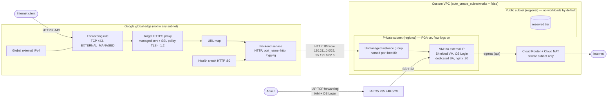

# Task 1 — Secure GCP Infrastructure with Terraform: Design

> **Status: revision 2 approved by Codex; implemented 2026-11-03.**
> Implementation deviations are listed in
> [§17](#17-implementation-notes-and-deviations) and marked inline.
> Validation results are in [README.md](README.md#validation).
> Nothing has been deployed. Google Cloud facts were checked against the
> official documentation on 2026-11-03 (sources in [§15](#15-references)).

## Contents

1. [PDF requirements matrix](#1-pdf-requirements-matrix)
2. [Architecture](#2-architecture)
3. [Diagram](#3-diagram)
4. [GCP resource inventory](#4-gcp-resource-inventory)
5. [Network and firewall traffic matrix](#5-network-and-firewall-traffic-matrix)
6. [SSH administration model](#6-ssh-administration-model)
7. [Load balancer and TLS design](#7-load-balancer-and-tls-design)
8. [IAM model](#8-iam-model)
9. [Terraform file structure](#9-terraform-file-structure)
10. [Validation strategy](#10-validation-strategy)
11. [Assumptions and external prerequisites](#11-assumptions-and-external-prerequisites)
12. [Known limitations](#12-known-limitations)
13. [Architecture decisions and trade-offs](#13-architecture-decisions-and-trade-offs)
14. [Implementation acceptance criteria](#14-implementation-acceptance-criteria)
15. [References](#15-references)
16. [Review history](#16-review-history)
17. [Implementation notes and deviations](#17-implementation-notes-and-deviations)

---

## 1. PDF requirements matrix

Source: *Cloud Security Engineer Technical Assessment*, section
"1. Secure GCP Infrastructure with Terraform". Quoted text is verbatim.

Intro sentence: *"Write a **Terraform module** that deploys the following
resources securely in **Google Cloud Platform (GCP)**."*

| ID | PDF requirement (verbatim) | Type | Proposed GCP implementation | Validation | Assumptions / ambiguities |
|----|----------------------------|------|-----------------------------|------------|---------------------------|
| R0 | "Write a Terraform module that deploys the following resources securely in Google Cloud Platform (GCP)" | Mandatory | A reusable child module at the task root (no `provider` or `backend` blocks), called from `examples/basic/`. | `terraform validate` on module and example; native tests. | "Securely" is open-ended. Interpreted as the controls in [§4–§8](#4-gcp-resource-inventory); extra hardening is optional and marked as such. |
| R1 | "A VPC network with a public and private subnet." | Mandatory | `google_compute_network` (custom mode, `auto_create_subnetworks = false`) and two regional `google_compute_subnetwork`s: `public` and `private`. | Tests assert two subnets, custom mode, distinct non-overlapping CIDRs. | GCP subnets have no public/private flag ([§2.1](#21-vpc-and-publicprivate-separation)). "Public"/"private" are a role defined by external-IP policy, firewall targets and NAT scope. |
| R2 | "A Compute Engine instance in the private subnet." | Mandatory | One `google_compute_instance` on the private subnet with **no `access_config`** (no external IP), Shielded VM, OS Login, a dedicated service account. | Tests assert the subnet and that `access_config` is empty. | "A" instance is read as exactly one VM, so an unmanaged instance group is used rather than a MIG ([§13 ADR-2](#13-architecture-decisions-and-trade-offs)). |
| R3 | "A Global HTTP Load Balancer in the public subnet that routes traffic to the Compute Engine instance." | Mandatory | Global external Application Load Balancer (`EXTERNAL_MANAGED`): global IP → global forwarding rule (443) → target HTTPS proxy → URL map → backend service → unmanaged instance group → VM. | Tests assert scheme, port, chain wiring. | **Conflict 1:** a global external ALB is a Google Front End service. It has no subnet and cannot be "placed in" a VPC subnet ([§2.3](#23-global-external-application-load-balancer)). **Conflict 2:** "HTTP Load Balancer" vs. the HTTPS-only rule in R4. Resolved as an HTTPS frontend on an *HTTP(S)/Application* LB (Google's old and new product names). |
| R4 | "Firewall rules that: Allow only HTTPS (443) from the internet to the Load Balancer." | Mandatory | Only one forwarding rule exists, on TCP 443. No port 80 frontend. Optional Cloud Armor policy hook. | Tests assert one forwarding rule with `port_range = "443"` and no port-80 frontend. | VPC firewall rules **do not apply** to GFE frontends. Google: *"You cannot use Google Cloud firewall rules to prevent traffic from reaching the load balancer."* The control is therefore the frontend definition (plus optional Cloud Armor), not a VPC firewall rule. This is explained in the README rather than adding a no-op firewall rule. |
| R5 | "Allow only SSH (22) from a trusted IP range (not 0.0.0.0/0) to the Compute Engine instance." | Mandatory | Ingress `allow tcp:22` from `var.ssh_source_ranges` to the VM's service account. Default `["35.235.240.0/20"]` (IAP TCP forwarding). Validation rejects `0.0.0.0/0`, `::/0` and any `/0`. | Tests assert source ranges. A validation test expects failure for `0.0.0.0/0`. | The VM has no external IP, so a public admin CIDR in this rule would **not** make it reachable from the internet. The trusted range must be the IAP range or a private range reachable over VPN/Interconnect ([§6](#6-ssh-administration-model)). |
| R6 | "Allow only HTTP (80) from the Load Balancer to the Compute Engine instance." | Mandatory | Ingress `allow tcp:80` from `130.211.0.0/22` and `35.191.0.0/16` to the VM's service account. | Tests assert exact sources, port and target. | These ranges are shared by all Google Front Ends, not only this LB ([§12](#12-known-limitations)). They are the documented mechanism. |
| R7 (implicit) | "routes traffic to the Compute Engine instance" | Mandatory | nginx is installed by an idempotent startup script with bounded retries and serves `/`. The VM is created only after Cloud NAT exists (`depends_on`). A health check on HTTP 80 makes the backend healthy. Cloud NAT (private subnet only) provides outbound package access. See [§2.5](#25-backend-bootstrap-dependencies-sequence-and-readiness). | Offline: structural tests of NAT coverage, dependency edge and script content, plus stubbed script tests. Runtime readiness **cannot be proven offline**. It needs an authorized deployment ([§10.3](#103-requires-credentials-not-run-in-this-assessment)). | The PDF does not specify an application. A minimal static page is assumed. |
| B1 | "Bonus: Implement least privilege IAM roles for resources instead of using roles/editor or roles/owner." | Bonus | Dedicated VM service account with **no project roles by default**. Admin access via instance-scoped `roles/iap.tunnelResourceAccessor` and `roles/compute.osLogin`, plus SA-scoped `roles/iam.serviceAccountUser`. Deployer roles documented separately. Validation rejects primitive roles. | Tests assert no `roles/owner|editor|viewer` and that the VM SA is not the default compute SA. | Some admin permissions (`compute.projects.get`, `compute.instances.list`) only exist at project level ([§8](#8-iam-model)). |

Not required by the PDF and **not** treated as mandatory: Cloud Armor, CMEK,
DNS records, MIG/autoscaling, Ops Agent, Cloud DNS, org policies, IPv6, HTTP→HTTPS
redirect. Where offered, these are optional inputs that are off by default.

---

## 2. Architecture

### 2.1 VPC and public/private separation

Subnets in Google Cloud are regional and have no routing-table association or
"public" flag: *"Subnets are regional resources, and have IP address ranges
associated with them."* The VPC routing table is network-wide: *"the routing
table for a VPC network is defined at the VPC network level"*. Internet egress
uses the system default route (`0.0.0.0/0` → default internet gateway). That
route is only usable by *"VMs with external IPv4 addresses"* or through *"A
public Cloud NAT gateway"*.

So in this design "public" and "private" are a **role**, enforced by the
following controls rather than by routing:

| Control | Public subnet | Private subnet |
|---------|---------------|----------------|
| External IPs on VMs | Allowed (intended tier for internet-facing VMs, if ever added) | **Never.** The module creates no `access_config`. Optional org policy `compute.vmExternalIpAccess` makes this a hard guarantee. |
| Ingress firewall | No allow rules target it (implied deny + logged explicit deny) | Only the LB/health-check→80 and trusted→22 rules, targeted by service account |
| Cloud NAT | Not attached | Attached (`LIST_OF_SUBNETWORKS`, private only) for outbound package installs |
| Private Google Access | On *(implementation: changed from Off, §17 D2)* | On |
| VPC Flow Logs | On | On |

**What lives in the public subnet?** Nothing, by default. The PDF asks for it.
A global external ALB cannot be placed in it, and a bastion host was rejected
in favour of IAP ([§13 ADR-4](#13-architecture-decisions-and-trade-offs)). The
subnet is created, logged and left as the designated tier for any future
internet-facing workload. This is stated openly in the README rather than
inventing a resource to fill it. **Question for reviewer (Q1).**

The system default route is kept (`delete_default_routes_on_create = false`).
Cloud NAT depends on it, and so does reaching Google APIs on the default
domains via Private Google Access.

### 2.2 Private Compute Engine VM

- `google_compute_instance`, one zone (`var.zone`, must be inside `var.region`).
- `network_interface { subnetwork = private }` with **no `access_config`**, so no external IP.
- Shielded VM: secure boot, vTPM and integrity monitoring on.
- Metadata: `enable-oslogin = "TRUE"`, `block-project-ssh-keys = "TRUE"`,
  `serial-port-enable = "FALSE"`.
- `can_ip_forward = false`. `deletion_protection = var.deletion_protection` (default `true`).
- Boot disk encrypted by default (Google-managed keys). Optional
  `boot_disk_kms_key_self_link` for CMEK.
- Image `var.boot_image`, default `debian-cloud/debian-12`. The image family
  must be confirmed during implementation (Debian 13 may be preferable).
- Dedicated service account with `cloud-platform` scope. Access is limited by
  IAM, as Google recommends: *"set the full `cloud-platform` access scope on the
  instance"* and *"control the service account's access using IAM roles"*.

**Backend integration:** an **unmanaged instance group** (`google_compute_instance_group`)
with `named_port { name = "http", port = 80 }` containing the single VM. Google
confirms unmanaged instance groups are valid backends for the global external
ALB. See [ADR-2](#13-architecture-decisions-and-trade-offs) for the comparison
with MIG and zonal NEG.

### 2.3 Global external Application Load Balancer

`EXTERNAL_MANAGED` (the current global external ALB, not the classic
`EXTERNAL`). All frontend components are **global** resources outside any VPC
subnet. Google: *"Proxy-only subnets are only required for regional external
Application Load Balancers."* The only VPC-attached parts are the backend
(instance group/VM) and the firewall rules that admit GFE traffic.

Chain:
`google_compute_global_address` → `google_compute_global_forwarding_rule` (TCP 443,
`EXTERNAL_MANAGED`) → `google_compute_target_https_proxy` (+ certificate + SSL
policy) → `google_compute_url_map` (default service only) →
`google_compute_backend_service` (`EXTERNAL_MANAGED`, `HTTP`, `port_name = "http"`)
→ `google_compute_instance_group` → VM. `google_compute_health_check`
(global, HTTP 80) is attached to the backend service.

`load_balancing_scheme = "EXTERNAL_MANAGED"` is set explicitly on both the
forwarding rule and the backend service, even though provider v8 made it the
default (provider v8 upgrade guide). The two must match.

### 2.4 Backend communication

| Purpose | Source ranges (IPv4) | Source |
|---------|----------------------|--------|
| LB proxy → backend (instance groups, zonal NEGs) | `130.211.0.0/22`, `35.191.0.0/16` | External ALB overview, firewall section |
| Health-check probes (global external ALB) | `35.191.0.0/16` | Health check concepts |

One firewall rule `allow tcp:80` from the union `{130.211.0.0/22, 35.191.0.0/16}`
covers both. Google advises: *"allow packets from the full health check
ranges"*. The design is IPv4-only (`stack_type = IPV4_ONLY`, IPv4 global
address), so the IPv6 ranges (`2600:2d00:1:1::/64`, `2600:2d00:1:b029::/64`)
are not added. Note: *"Google Cloud can implement new probers automatically
without notification"*, so the ranges are held in one `locals` block with a
doc link.

Backend protocol is plain HTTP on port 80, as the PDF requires. Google: *"The
load balancer only uses the backend service protocol that you specify"*, and
HTTP sends traffic *without TLS*. This is not hidden; HTTPS-to-backend is listed
as production hardening ([§12](#12-known-limitations)).

### 2.5 Backend bootstrap: dependencies, sequence and readiness

*(Rewritten in revision 2: Codex finding M1.)*

The VM has no external IP. Its only path to the Debian package mirrors is
Cloud NAT. Google: *"VMs without external IP addresses can access destinations
on the internet"* through Cloud NAT, which *"doesn't allow unsolicited inbound
connections."* If the VM boots before NAT exists, the first-boot `apt-get`
fails. The design therefore makes the dependency explicit, and makes the
script tolerate the remaining timing gaps.

#### 2.5.1 Egress path: routes, NAT and subnet coverage

| Element | Configuration | Why |
|---------|---------------|-----|
| Default route | System-generated `0.0.0.0/0` → default internet gateway, created with the VPC because `delete_default_routes_on_create = false`. No custom routes are created. | Google: a public Cloud NAT gateway *"always depend[s] on a local IPv4 static route that uses the default internet gateway next hop."* This route is not a Terraform resource, so the flag that keeps it is asserted in tests. |
| Subnet routes | System-generated for each subnet | Intra-VPC reachability (not used by the bootstrap) |
| Cloud Router | `google_compute_router.nat`: `network = google_compute_network.this.id`, `region = var.region` | NAT is regional and must sit in the same region and VPC as the private subnet |
| Cloud NAT | `google_compute_router_nat.this`: `router = google_compute_router.nat[0].name`, `region = var.region`, `nat_ip_allocate_option = "AUTO_ONLY"`, `source_subnetwork_ip_ranges_to_nat = "LIST_OF_SUBNETWORKS"`, `log_config { enable = true, filter = "ERRORS_ONLY" }` | Outbound only. Auto-allocated NAT IPs. Errors (e.g. port exhaustion) logged. |
| NAT subnet coverage | Exactly one `subnetwork { name = google_compute_subnetwork.private.self_link, source_ip_ranges_to_nat = ["PRIMARY_IP_RANGE"] }` | Only the private subnet's primary range is NATed (no secondary ranges exist). The **public subnet is not listed** and gets no NAT. |
| Private Google Access | On for the private subnet | Google API traffic does not need NAT |

All `subnetwork` block fields above appear in the provider v8.9.0
`google_compute_router_nat` docs. `name` is documented as *"Self-link of
subnetwork to NAT"*.

#### 2.5.2 Terraform dependency model

Implicit (by reference): `network → private subnet`, `network → router`,
`router + private subnet → NAT`, `private subnet + VM SA → instance`.

**Explicit:** the instance has no attribute that refers to NAT, so Terraform
would otherwise create the VM in parallel with the router and NAT. The design
adds:

```hcl
resource "google_compute_instance" "this" {
  # ...
  depends_on = [google_compute_router_nat.this]
}
```

- `depends_on` names the whole resource, so it stays valid when
  `enable_cloud_nat = false` and the NAT has `count = 0`.
- `depends_on` gives **ordering, not readiness**. It guarantees the NAT API
  operation finished before the VM create call. It does not guarantee the NAT
  data plane is programmed when the guest runs `apt-get`. The bounded retries
  in §2.5.3 cover that gap.
- No other `depends_on` is added. Firewall rules, the instance group and the
  LB chain are ordered by references, and backend health is a runtime state,
  not a Terraform dependency.

#### 2.5.3 Startup script design

The script is a plain file, `files/startup.sh`, loaded with
`metadata_startup_script = file("${path.module}/files/startup.sh")`. It has no
template variables and no secrets, so `shellcheck` and `bash -n` can check the
exact bytes shipped. Per the provider docs, changing `metadata_startup_script`
*"forces the instance to be recreated"*. This is accepted: a script change
yields a clean rebuild.

Behaviour, in order:

1. `set -Eeuo pipefail`. An `ERR` trap records the failing step.
2. **Single run at a time:** `flock` on `/run/secure-web-bootstrap.lock`.
3. **Idempotent install:** if `dpkg-query` reports `nginx` as installed, skip
   the install step. This covers reboots (Google runs startup scripts on every
   boot) and pre-baked images used with `enable_cloud_nat = false`.
4. **Bounded retries with exponential backoff:**
   `apt-get update` then `apt-get install -y --no-install-recommends nginx`,
   with `DEBIAN_FRONTEND=noninteractive`, `-o DPkg::Lock::Timeout=120` (first-boot
   apt jobs may hold the lock) and `-o Acquire::Retries=3`. Each attempt is
   wrapped in `timeout 120`. **5 attempts**, sleeping 10, 20, 40, 80 s
   between them. Worst case is about 5 × 120 + 150 ≈ 12.5 minutes, after which
   the step fails. There is no unbounded loop.
5. **Idempotent content:** write `index.html` to a temp file and install it
   only if it differs (`cmp -s`), mode `0644`, owner root.
6. `systemctl enable --now nginx`, which is idempotent.
7. **Local self-check:** up to 5 attempts, 2 s apart, of
   `curl -fsS -o /dev/null http://127.0.0.1/` plus `systemctl is-active --quiet nginx`.
   (`curl` in the Debian GCE image is to be confirmed during implementation;
   the fallback is bash `/dev/tcp`.)
8. **Success:** write `/var/lib/secure-web/bootstrap.ok` (timestamp), delete
   any `bootstrap.failed`, and log `SECURE_WEB_BOOTSTRAP=OK`.
9. **Clear failure condition, fail closed** *(corrected after the Codex final
   review, §17 D14)*:
   - On any failed step, remove any stale `bootstrap.ok`, write
     `/var/lib/secure-web/bootstrap.failed` with the step name, log
     `SECURE_WEB_BOOTSTRAP=FAILED step=<name>`, and exit non-zero.
   - If this run holds the bootstrap lock, it also runs `systemctl stop nginx`
     and `systemctl disable nginx`. The original rev-2 wording assumed nginx
     would "then not be serving". That was false when nginx was already
     running from an earlier boot.
   - With nginx stopped, the health check marks the backend **UNHEALTHY** and
     the LB stops sending it traffic.
   - A run that failed to get the lock leaves nginx to the lock owner.
   - A later successful run re-enables nginx. The success marker is also
     cleared at the start of every run, so a marker can only reflect the
     current run.

Startup-script output goes to the guest journal
(`google-startup-scripts.service`) and to serial port output. `serial-port-enable
= FALSE` only disables the *interactive* serial console, not reading output.

For offline tests, two environment variables override timing only:
`BOOTSTRAP_BACKOFF_BASE_SECONDS` and `BOOTSTRAP_MAX_ATTEMPTS`. They are unset
on GCE, so the defaults above apply. The bounds are clamped (max attempts ≤ 10)
so an override can't make the loop unbounded.

#### 2.5.4 Bootstrap sequence

1. `terraform apply` creates network → subnets → router → NAT.
2. NAT create completes → VM created (`depends_on`) → instance group → backend service.
3. VM boots. The guest agent runs `startup.sh`: install (with retries) → configure → start nginx → local self-check → `bootstrap.ok`.
4. Health checks from `35.191.0.0/16` hit `:80`. After 2 consecutive successes the backend is `HEALTHY`.
5. GFEs forward client traffic from `130.211.0.0/22` / `35.191.0.0/16` to `:80`.
6. Clients reach `https://<domain>` after the certificate is ACTIVE ([§7.2](#72-what-terraform-can-and-cannot-do)).

#### 2.5.5 What a successful apply does and does not prove

- `terraform apply` succeeding proves that the API resources exist and the VM
  reached `RUNNING`. It does **not** prove that the startup script ran, that
  nginx is installed, or that the backend is healthy. Startup scripts run
  asynchronously inside the guest after Terraform returns.
- **The readiness signal is the load balancer health check**, plus the
  `SECURE_WEB_BOOTSTRAP=OK` log line and the `bootstrap.ok` marker. Required
  verification steps are in [§10.3](#103-requires-credentials-not-run-in-this-assessment).
- **Runtime backend readiness cannot be proven without an authorized
  deployment.** Offline tests can prove the configuration, dependency ordering
  and script logic only. The README will state this and will not claim
  runtime results that were not observed.

#### 2.5.6 Without NAT

With `enable_cloud_nat = false`, the VM has no internet egress. The bootstrap
then succeeds only if the image already contains nginx (step 3 skips the
install). *(Implementation, §17 D1:* instead of a warning, variable
validation **rejects** `enable_cloud_nat = false` unless
`boot_image_includes_nginx = true`.*)* Pre-baking an image is documented, not
implemented.

### 2.6 What is deliberately not built

No bastion, no MIG/autoscaler, no Cloud DNS zone, no Ops Agent, no Cloud Armor
policy (only an input to attach an existing one), no org policies, no project
API enablement inside the module. These are explained in [§11](#11-assumptions-and-external-prerequisites)–[§13](#13-architecture-decisions-and-trade-offs).

---

## 3. Diagram



ASCII fallback:

```
Client --443--> [Global IP + FR:443] -> [HTTPS proxy: cert, TLS>=1.2] -> [URL map] -> [Backend svc HTTP]
                                                                                        |  (130.211.0.0/22, 35.191.0.0/16 -> tcp:80)
VPC ------------------------------------------------------------------------------------|----------
  public subnet  : (empty, reserved)                                                    v
  private subnet : [UIG http:80] -> [VM, no ext IP] --egress--> [Cloud NAT] --> Internet
                                       ^
Admin --IAP (IAM, OS Login)--> 35.235.240.0/20 --tcp:22--+
```

---

## 4. GCP resource inventory

Names use `${var.name_prefix}-<role>`. Labels from `var.labels` are applied
where the resource supports them.

| # | Terraform resource | Scope | Purpose | Key security settings |
|---|--------------------|-------|---------|-----------------------|
| 1 | `google_compute_network.this` | global | Custom VPC | `auto_create_subnetworks = false`, `routing_mode = "REGIONAL"` |
| 2 | `google_compute_subnetwork.public` | regional | Public tier | flow logs (`log_config`), `IPV4_ONLY` |
| 3 | `google_compute_subnetwork.private` | regional | Private tier | `private_ip_google_access = true`, flow logs, `IPV4_ONLY` |
| 4 | `google_compute_firewall.allow_lb_to_backend_http` | global (VPC) | R6 | ingress, `tcp:80`, sources = GFE ranges, `target_service_accounts = [vm_sa]`, logging |
| 5 | `google_compute_firewall.allow_ssh_trusted` | global (VPC) | R5 | ingress, `tcp:22`, sources = `var.ssh_source_ranges`, target = VM SA, logging |
| 6 | `google_compute_firewall.deny_all_ingress` | global (VPC) | Logged default deny | ingress, deny all, `0.0.0.0/0`, priority 65534, logging (the implied deny rule is not logged) |
| 7 | `google_compute_router.nat` | regional | Cloud Router for NAT | count = `enable_cloud_nat ? 1 : 0` |
| 8 | `google_compute_router_nat.this` | regional | Outbound only for the private subnet | `LIST_OF_SUBNETWORKS` with one `subnetwork` block (private self-link, `PRIMARY_IP_RANGE`), `AUTO_ONLY`, `log_config { enable = true, filter = "ERRORS_ONLY" }`. See [§2.5.1](#251-egress-path-routes-nat-and-subnet-coverage). |
| 9 | `google_service_account.vm` | project | Workload identity of the VM | no keys created |
| 10 | `google_project_iam_member.vm` | project | Optional roles for VM SA | `for_each = var.vm_service_account_roles`, default `[]`, primitive roles rejected |
| 11 | `google_compute_instance.this` | zonal | Backend VM | no `access_config`, Shielded VM, OS Login metadata, dedicated SA, `deletion_protection`, `metadata_startup_script = file("files/startup.sh")`, **`depends_on = [google_compute_router_nat.this]`** |
| 12 | `google_compute_instance_group.this` | zonal | Backend container | `named_port http:80` |
| 13 | `google_compute_health_check.http` | global | Backend health | HTTP `:80`, `request_path = var.health_check_path`, `log_config { enable = true }` |
| 14 | `google_compute_backend_service.this` | global | LB backend | `EXTERNAL_MANAGED`, `HTTP`, `port_name = "http"`, `log_config { enable = true }`, optional `security_policy` |
| 15 | `google_compute_url_map.this` | global | Routing | `default_service` only |
| 16 | `google_compute_ssl_policy.this` | global | TLS policy | `profile = var.ssl_policy_profile` (default `RESTRICTED`), `min_tls_version` (default `TLS_1_2`). `TLS_1_3` requires `RESTRICTED`, enforced by validation and a precondition ([§7.3](#73-tls-policy)). |
| 17 | `google_compute_managed_ssl_certificate.this` | global | Google-managed cert | count = 1 only when `managed_certificate_domains` is non-empty |
| 18 | `google_compute_target_https_proxy.this` | global | TLS termination | `ssl_certificates`, `ssl_policy` |
| 19 | `google_compute_global_address.this` | global | Frontend IP | `address_type = "EXTERNAL"`, `ip_version = "IPV4"` |
| 20 | `google_compute_global_forwarding_rule.https` | global | Frontend 443 | `EXTERNAL_MANAGED`, `ip_protocol = "TCP"`, `port_range = "443"` |
| 21 | `google_iap_tunnel_instance_iam_member.ssh` | instance | IAP tunnel access | `for_each = var.ssh_admin_members` |
| 22 | `google_compute_instance_iam_member.os_login` | instance | OS Login | `roles/compute.osLogin` (not `osAdminLogin`) |
| 23 | `google_service_account_iam_member.ssh_admin_sa_user` | SA | Required by OS Login when VM has an SA | `roles/iam.serviceAccountUser` on **this SA only** |

All arguments above were checked against the `hashicorp/google` **v8.9.0**
resource docs (fetched from the provider repository at tag `v8.9.0`). The full
schema dump could not be produced locally, see [§10.4](#104-local-tooling-status).

---

## 5. Network and firewall traffic matrix

Implied rules in every VPC: deny all ingress, allow all egress. A new custom VPC
gets **no** pre-populated allow rules.

| # | Direction | Source | Destination | Protocol/port | Action | Enforced by | Req. |
|---|-----------|--------|-------------|---------------|--------|-------------|------|
| T1 | Internet → LB | `0.0.0.0/0` | Global IP | TCP 443 | Allow (TLS terminated at GFE) | Forwarding rule exists only for 443. Optional Cloud Armor. **Not a VPC firewall rule** (not possible for GFEs). | R4 |
| T2 | Internet → LB | `0.0.0.0/0` | Global IP | TCP 80 / any other | No listener → not served | Absence of any other forwarding rule | R4 |
| T3 | GFE → VM | `130.211.0.0/22`, `35.191.0.0/16` | VM SA target | TCP 80 | Allow, logged | FW #4 (priority 1000) | R6 |
| T4 | Health check → VM | `35.191.0.0/16` | VM SA target | TCP 80 | Allow, logged | FW #4 | R6/R7 |
| T5 | Trusted → VM | `var.ssh_source_ranges` (default IAP `35.235.240.0/20`) | VM SA target | TCP 22 | Allow, logged | FW #5 (priority 1000) | R5 |
| T6 | Anything else → any VM | `0.0.0.0/0` | all | all | Deny, logged | FW #6 (priority 65534) | hardening |
| T7 | Internet → VM directly | any | VM | any | Impossible: no external IP; NAT is outbound-only | Instance config, Cloud NAT semantics | R2 |
| T8 | VM → Internet | VM | any | any | Allowed via Cloud NAT (implied egress allow) | Cloud NAT | R7 |
| T9 | VM → Google APIs | VM | `*.googleapis.com` | 443 | Allowed via Private Google Access | Subnet setting | — |
| T10 | VM → metadata server | VM | `169.254.169.254` | 80 | Always allowed (not subject to VPC firewall) | Platform | — |

Firewall targets use **`target_service_accounts`**, not network tags.
Changing a VM's service account requires stopping the VM and having
`iam.serviceAccounts.actAs`, whereas tags can be edited by anyone with
`compute.instances.setTags`.

Egress restriction (deny-all egress + allow 80/443) is optional hardening, not
the default. The PDF does not require it, and it would need careful exceptions
for apt mirrors.

---

## 6. SSH administration model

### 6.1 Options evaluated

| Option | How SSH reaches the VM | Firewall source for R5 | Verdict |
|--------|------------------------|------------------------|---------|
| A. **IAP TCP forwarding** (default) | Admin → IAP (authN + IAM) → tunnel from `35.235.240.0/20` → VM:22. *"Your VM instance doesn't require an external IP address for IAP TCP forwarding."* | `35.235.240.0/20` | **Chosen default.** No public listener, IAM-gated, audited, per-VM grants. |
| B. Private connectivity (Cloud VPN / Interconnect / peered VPC) | Admin network → VPN → VM private IP:22 | Corporate private CIDR(s), e.g. `10.20.0.0/16` | **Supported** by setting `ssh_source_ranges`. VPN itself is out of scope (external prerequisite). |
| C. Bastion with external IP in the public subnet | Admin public IP → bastion:22 → VM:22 | Admin public CIDR → bastion; bastion SA → VM | **Rejected.** Adds an internet-facing SSH listener and a second VM to patch. IAP gives the same result with less exposure. |
| D. Trusted public CIDR straight to the VM | — | Admin public CIDR | **Invalid.** The VM has no external IP, so a public source range in the firewall does not make it reachable. It would be a misleading rule. |

### 6.2 How this satisfies the PDF wording

*"Allow only SSH (22) from a trusted IP range (not 0.0.0.0/0) to the Compute
Engine instance"* is implemented as one firewall rule whose source is a
caller-supplied list of trusted ranges, validated so it can never contain a
`/0`. With IAP, the trusted range is Google's IAP forwarder range. Who may
use it is decided by IAM, not by the client's IP.

To limit IAP SSH to specific client IPs as well, Google supports IAM conditions
that require an Access Context Manager access level. That needs an
organization, so it is documented as optional hardening, not implemented.

### 6.3 Identity and keys

- OS Login (`enable-oslogin=TRUE`) ties SSH to Google identities. No
  metadata SSH keys (`block-project-ssh-keys=TRUE`).
- Per-admin grants, all resource-scoped:
  - `roles/iap.tunnelResourceAccessor` on **the instance** (Google supports a
    per-VM grant for this role).
  - `roles/compute.osLogin` on **the instance** (not `osAdminLogin`, so no sudo
    by default; `ssh_admin_sudo = true` switches to `osAdminLogin`).
  - `roles/iam.serviceAccountUser` on **the VM's SA**. Google requires this
    for OS Login when the VM has a service account.
- Project-level permissions that cannot be scoped lower. Per the docs,
  `gcloud compute ssh` needs `compute.projects.get`, `compute.instances.get`
  and `compute.instances.list`. Google: *"for SSH from the Google Cloud console
  or gcloud CLI … you must grant these roles at the project level"* or grant a
  project role containing `compute.projects.get`. These are **documented, not
  granted by the module**, for example `roles/compute.viewer` at project level.
  **Question for reviewer (Q3).**
- `roles/compute.instanceAdmin.v1`, which the IAP page lists for SSH, is only
  needed for metadata-key SSH. It is **not** granted, because OS Login replaces
  that path.

### 6.4 Access modes and connect commands

*(Added in revision 2: Codex finding L1.)*

| | **Mode 1: IAP (default)** | **Mode 2: private connectivity (optional)** |
|---|---|---|
| Prerequisite | IAP API enabled; admin holds the roles in §6.3 | **Existing** Cloud VPN / Interconnect / peered network that routes the admin's network to the private subnet. Not created by this module. |
| `ssh_source_ranges` | `["35.235.240.0/20"]` (default) | The admin network's **private** CIDR(s), e.g. `["10.20.0.0/16"]`. Add `35.235.240.0/20` as well to keep IAP. |
| Command | `gcloud compute ssh INSTANCE --zone ZONE --project PROJECT --tunnel-through-iap` | `gcloud compute ssh INSTANCE --zone ZONE --project PROJECT --internal-ip` |
| Path | Admin → IAP (Google identity, IAM check) → TCP from `35.235.240.0/20` → VM:22 | Admin → VPN/Interconnect → VM private IP:22 |
| Source IP seen by the VM firewall | An IAP forwarder address in `35.235.240.0/20` | The admin's private IP |

**IAP's source CIDR is not the administrator's IP.** `35.235.240.0/20` is
Google's IAP forwarder range. Every IAP-tunnelled connection arrives from it,
whoever the user is and wherever they are. Allowing it in the firewall means
"allow IAP", and the real control is IAM on the tunnel plus OS Login. VPC
firewall logs therefore show IAP addresses, not the user's address. User
identity is recorded by IAP audit logs (IAP Data Access audit logs must be
enabled at project level; this is a prerequisite, not done by the module) and
OS Login, not by the firewall.
Limiting IAP to specific client IPs needs an Access Context Manager access
level (§6.2).

`--internal-ip` only works if the client host can route to the VM's private
IP. Without that connectivity, Mode 2 fails, and adding a private CIDR to
`ssh_source_ranges` alone does nothing.

Module outputs: `ssh_command_iap` (always) and `ssh_command_internal_ip`
(always emitted, with a description noting it requires Mode 2 connectivity).

---

## 7. Load balancer and TLS design

### 7.1 Certificate strategy

Two mutually exclusive inputs. Exactly one must be set, enforced by
cross-variable validation (Terraform ≥ 1.9):

| Input | Resource | Use |
|-------|----------|-----|
| `managed_certificate_domains` (list) | `google_compute_managed_ssl_certificate` | **Default path.** Google issues and renews. No key material in Terraform or state. |
| `ssl_certificate_self_links` (list) | none (references existing) | Bring-your-own certificate, created outside Terraform (e.g. by a PKI team). Keeps private keys out of this state. |

**Not supported on purpose:** passing a PEM private key into
`google_compute_ssl_certificate`. The key would be stored in plaintext in
Terraform state.

Certificate Manager (`certificate_manager_certificates` on the proxy) is a
valid alternative. It is left out to keep scope small; see [§12](#12-known-limitations).

### 7.2 What Terraform can and cannot do

| Step | Terraform? | Notes |
|------|-----------|-------|
| Reserve global IP | Yes | Output `load_balancer_ip` |
| Create managed certificate object | Yes | Status starts as `PROVISIONING` |
| Own the domain | **No** | External prerequisite |
| Create DNS A record → LB IP | **No (out of module scope)** | Required for issuance. Google: A/AAAA records must point to the forwarding rule IP; *"Extra addresses in the record can cause validation to fail."* |
| Certificate becomes ACTIVE | **No** | Up to 60 min after DNS propagates. DNS can take up to 72 h. LB may take up to 30 min more to serve it. |
| Forwarding rule on TCP 443 | Yes | Google requires 443 for managed-cert validation, which matches R4 |

Consequence: `terraform apply` succeeds before HTTPS works end to end. The
README must say so.

### 7.3 TLS policy

*(Rewritten in revision 2: Codex finding M2.)*

`google_compute_ssl_policy` attached to the target HTTPS proxy. Global SSL
policies are supported by the *"Global external Application Load Balancer"*
(SSL policies overview).

**Default (unchanged from revision 1):** `profile = "RESTRICTED"`,
`min_tls_version = "TLS_1_2"`.

**Google's constraint.** Two sources agree:
- SSL policies overview: for a minimum of TLS 1.3, *"the policy must use the
  `RESTRICTED` profile."* The other profiles *"don't let you select the minimum
  TLS version to 1.3."* Also, `FIPS_202205` *"must use a minimum TLS version of 1.2."*
- Provider v8.9.0 `google_compute_ssl_policy` docs: *"When set to `TLS_1_3`, the
  profile field must be set to `RESTRICTED`."*

**Combination matrix** (rows = profile, columns = `min_tls_version`):

| Profile | `TLS_1_0` | `TLS_1_1` | `TLS_1_2` | `TLS_1_3` |
|---------|-----------|-----------|-----------|-----------|
| `RESTRICTED` | Not forbidden by Google; **rejected by module** | Not forbidden by Google; **rejected by module** | **Accepted (default)** | **Accepted** |
| `MODERN` | Not forbidden by Google; **rejected by module** | Not forbidden by Google; **rejected by module** | **Accepted** | **Invalid per Google → rejected** |
| `COMPATIBLE` | **rejected by module** (profile not allowed) | rejected | rejected | Invalid per Google → rejected |
| `FIPS_202205` | Invalid per Google | Invalid per Google | Valid per Google; **rejected by module** (out of scope) | Invalid per Google |
| `CUSTOM` | **rejected by module** (would need `custom_features`) | rejected | rejected | rejected |

So the module accepts exactly three combinations:
**`RESTRICTED`+`TLS_1_2`** (default), **`RESTRICTED`+`TLS_1_3`**, **`MODERN`+`TLS_1_2`**.

**Enforcement (three layers):**

1. Per-variable validation:
   - `ssl_policy_profile ∈ {MODERN, RESTRICTED}`
   - `ssl_min_tls_version ∈ {TLS_1_2, TLS_1_3}`
2. **Cross-variable validation** on `ssl_min_tls_version`:
   ```hcl
   validation {
     condition     = var.ssl_min_tls_version != "TLS_1_3" || var.ssl_policy_profile == "RESTRICTED"
     error_message = "ssl_min_tls_version = TLS_1_3 requires ssl_policy_profile = RESTRICTED (Google Cloud SSL policy constraint)."
   }
   ```
   Referring to another variable in a validation rule needs **Terraform ≥ 1.9**.
   The Terraform v1.9.0 release notes: validation rules *"can refer to other
   input variables and to other objects such as data resources."* The module
   pins `required_version = ">= 1.9"`, so older CLIs fail at `init` with a clear
   version error instead of silently skipping the check.
3. **Resource precondition** on `google_compute_ssl_policy.this` with the same
   condition. Preconditions exist since Terraform 1.2. This keeps the rule next
   to the resource, so it holds even if the variable validation is later edited.

No other arguments are set on the SSL policy (`custom_features` must be absent
for non-`CUSTOM` profiles; `post_quantum_key_exchange` keeps its provider
default).

Tests: see [§10.2](#102-native-test-assertions-planned) (TLS cases T-TLS-1…T-TLS-7).

### 7.4 Other LB settings

- No port-80 forwarding rule and no HTTP→HTTPS redirect URL map, because R4
  says *only* 443. Optional `enable_http_redirect` (default `false`) can be
  discussed. **Question for reviewer (Q2).**
- Backend service and health check logging on (`sample_rate = 1.0`, variable).
- Optional `security_policy` (Cloud Armor self-link), default `null`.
- Health check: HTTP `:80`, path `/`, interval 10 s, timeout 5 s, healthy 2,
  unhealthy 3.

---

## 8. IAM model

### 8.1 Workload (VM) service account

| Item | Design |
|------|--------|
| Identity | `google_service_account.vm` (`${name_prefix}-vm`). Never the default compute SA. Google: *"create a user-managed service account"* and *"grant it only the roles your application needs"*. |
| Roles | **None by default.** nginx serving a static page needs no Google API access. |
| Optional roles | `var.vm_service_account_roles` (e.g. `roles/logging.logWriter`, `roles/monitoring.metricWriter` if the Ops Agent is added). *(Corrected, §17 D15.)* **Explicit allowlist**: only `roles/logging.logWriter` and `roles/monitoring.metricWriter` are accepted, checked by variable validation and again by a precondition on `google_project_iam_member.vm`. The rev-2 name rule ("ends in admin") wrongly accepted roles such as `roles/compute.instanceAdmin.v1`; a role name proves nothing about privilege. |
| Keys | None. The module never creates `google_service_account_key`. Credentials come from the metadata server. |
| Scopes | `cloud-platform`, with access limited by IAM (Google best practice). |

### 8.2 Human administrators (module-managed, resource-scoped)

See [§6.3](#63-identity-and-keys). Input `ssh_admin_members` (list of `user:`,
`group:` or `serviceAccount:` principals). Validation rejects `allUsers`,
`allAuthenticatedUsers` and unprefixed strings. Groups are recommended.

### 8.3 Terraform deployer (documented, not managed)

The identity running `terraform apply` is out of module scope. Use
**short-lived credentials**: ADC from `gcloud auth application-default login`,
service-account impersonation, or Workload Identity Federation in CI. Never use
a JSON key.

| Role (predefined) | Why |
|-------------------|-----|
| `roles/compute.networkAdmin` | VPC, subnets, router, NAT, global address, LB resources, health checks, SSL policy and certificates |
| `roles/compute.securityAdmin` | Firewall rules, SSL policies/certificates |
| `roles/compute.instanceAdmin.v1` | VM and instance group |
| `roles/iam.serviceAccountAdmin` | Create the VM SA and set IAM on it |
| `roles/iam.serviceAccountUser` (on the VM SA, or project if SA is created in the same apply) | Attach the SA to the VM (`actAs`) |
| `roles/iap.admin` | Set IAM on the IAP tunnel instance resource |
| `roles/resourcemanager.projectIamAdmin` | **Only if** `vm_service_account_roles` is non-empty. Can be replaced by a custom role. |

The overlap between `networkAdmin` and `securityAdmin` (SSL objects) is
intentional; they are Google's standard LB-admin pairing. A single custom role
with exactly the needed `compute.*` permissions is the tighter alternative and
is noted as a production step. **Question for reviewer (Q4)** on whether to ship
that custom role definition as documentation.

---

## 9. Terraform file structure

```
task-01-gcp-terraform/
├── README.md                    # requirements (verbatim), usage, validation, results
├── DESIGN.md                    # this document
├── versions.tf                  # required_version >= 1.9; google ~> 8.9 (no provider block)
├── variables.tf                 # inputs + validation
├── main.tf                      # locals: names, GFE/HC ranges, labels (was locals.tf, §17 D5)
├── network.tf                   # VPC, subnets, router, NAT
├── firewall.tf                  # 3 firewall rules
├── iam.tf                       # VM SA, optional project roles, admin bindings
├── compute.tf                   # VM, instance group
├── load_balancer.tf             # HC, backend svc, URL map, SSL policy, cert, proxy, IP, FR
├── outputs.tf
├── files/
│   └── startup.sh               # plain bash (no template vars): idempotent, bounded retries; no secrets
├── tests/
│   ├── secure_defaults.tftest.hcl   # mock_provider, plan-level assertions
│   ├── bootstrap.tftest.hcl         # NAT coverage, route flag, startup-script wiring
│   ├── tls_policy.tftest.hcl        # TLS combination matrix (positive + negative)
│   ├── input_validation.tftest.hcl  # expect_failures for other bad inputs
│   ├── iam.tftest.hcl               # IAM grants and role rejections (added, §17 D6)
│   ├── static_checks.sh             # inventory, forbidden patterns, VM->NAT graph edge (§17 D6)
│   └── bootstrap/
│       └── test_startup.sh          # runs files/startup.sh against stubs it generates (§17 D6)
├── examples/
│   └── basic/
│       ├── versions.tf
│       ├── providers.tf         # provider "google" { project, region } via ADC; no credentials
│       ├── main.tf              # module "secure_web" { source = "../.." }
│       ├── variables.tf
│       ├── outputs.tf
│       ├── terraform.tfvars.example   # fake values only (example-project-id, app.example.com)
│       └── backend.tf.example         # GCS backend template
├── .tflint.hcl                  # terraform "all" preset + google ruleset (pinned)
├── .gitattributes               # LF for scripts (§17 D8)
└── .terraform.lock.hcl          # committed (root of tests); example has its own lock
```

**Why no `providers.tf` at module root:** HashiCorp guidance is that reusable
modules declare `required_providers` but do not configure providers. The
provider block lives in `examples/basic/providers.tf`, which meets the
"providers.tf" request without making the module hard to reuse.

### 9.1 Versions

- Terraform `>= 1.9` (cross-variable validation; `mock_provider` needs ≥ 1.7).
  Latest release reported by the CLI on 2026-11-03: 1.17.1.
- `hashicorp/google` `~> 8.9` (latest on the registry on 2026-11-03: 8.9.0).
  `google-beta` is not needed.

### 9.2 Variables

| Variable | Type | Default | Validation |
|----------|------|---------|------------|
| `project_id` | string | **required** | `^[a-z][a-z0-9-]{4,28}[a-z0-9]$` |
| `region` | string | **required** | non-empty, `^[a-z]+-[a-z]+[0-9]+$` |
| `zone` | string | **required** | `startswith(zone, "${region}-")` (cross-var) |
| `name_prefix` | string | `"secure-web"` | `^[a-z][a-z0-9-]{0,19}$` (keeps derived names ≤ 63) |
| `public_subnet_cidr` | string | `"10.10.0.0/24"` | canonical IPv4, /8–/29, **entire range** inside one RFC 1918 block (§17 D4, D16) |
| `private_subnet_cidr` | string | `"10.10.1.0/24"` | as above; must not overlap public |
| `ssh_source_ranges` | list(string) | `["35.235.240.0/20"]` | non-empty; each valid CIDR; no `/0` |
| `ssh_admin_members` | list(string) | `[]` | prefix `user:`/`group:`/`serviceAccount:`; no `allUsers`/`allAuthenticatedUsers` |
| `ssh_admin_sudo` | bool | `false` | — |
| `machine_type` | string | `"e2-small"` | non-empty |
| `boot_image` | string | `"debian-cloud/debian-12"` | non-empty |
| `boot_disk_size_gb` | number | `20` | 10–100 |
| `boot_disk_kms_key_self_link` | string | `null` | null or `projects/.../cryptoKeys/...` |
| `managed_certificate_domains` | list(string) | `[]` | exactly one of this / `ssl_certificate_self_links` non-empty; FQDN regex |
| `ssl_certificate_self_links` | list(string) | `[]` | see above |
| `ssl_policy_profile` | string | `"RESTRICTED"` | `MODERN` or `RESTRICTED` |
| `ssl_min_tls_version` | string | `"TLS_1_2"` | `TLS_1_2` or `TLS_1_3`; **cross-variable:** `TLS_1_3` ⇒ profile `RESTRICTED` (+ resource precondition) ([§7.3](#73-tls-policy)) |
| `health_check_path` | string | `"/"` | starts with `/` |
| `enable_cloud_nat` | bool | `true` | — |
| `security_policy` | string | `null` | — |
| `vm_service_account_roles` | set(string) | `[]` | allowlist: `roles/logging.logWriter`, `roles/monitoring.metricWriter` only (§17 D15) |
| `deletion_protection` | bool | `true` | — |
| `labels` | map(string) | `{}` | GCP label key/value regex |

### 9.3 Outputs

`load_balancer_ip`, `https_url` (first managed domain, if any),
`network_self_link`, `public_subnet_self_link`, `private_subnet_self_link`,
`instance_name`, `instance_self_link`, `instance_internal_ip`,
`vm_service_account_email`, `backend_service_id`, `managed_certificate_name`,
`ssh_command_iap`, `ssh_command_internal_ip` ([§6.4](#64-access-modes-and-connect-commands)).
No sensitive values are produced.

### 9.4 Resource relationships

`network → subnets → (router → NAT[private])`;
`SA → instance → instance group → backend service ← health check`;
`backend service → URL map → HTTPS proxy ← (cert, SSL policy)`;
`HTTPS proxy + global address → forwarding rule`;
`SA → firewall rules (target_service_accounts)`;
`instance → IAP/OS Login bindings`; `SA → serviceAccountUser bindings`.

**One explicit `depends_on`:** `google_compute_instance.this` →
`google_compute_router_nat.this` ([§2.5.2](#252-terraform-dependency-model)).
It exists because the VM's first-boot script needs NAT and nothing in the
instance refers to NAT. All other ordering comes from references.

---

## 10. Validation strategy

### 10.1 Offline (no credentials, no cloud API calls)

| Step | Command | Where | Notes |
|------|---------|-------|-------|
| Format | `terraform fmt -check -recursive` | task root | |
| Init | `terraform init -backend=false` | task root and `examples/basic` | Downloads the provider from the public registry only |
| Validate | `terraform validate` | task root and `examples/basic` | |
| Native tests | `terraform test` | task root | `mock_provider "google" {}`. `command = plan`, or `command = apply` **against the mock only** where a computed value such as a self-link must be compared. No credentials, no API calls. |
| Dependency edge | `bash tests/static_checks.sh` (check S5) | task root | Runs `terraform graph` (offline after `init`) and fails unless an edge `google_compute_instance.this → google_compute_router_nat.this` exists. Confirmed format with Terraform 1.17.1: `"google_compute_instance.this" -> "google_compute_router_nat.this"`. |
| Script lint | `bash -n files/startup.sh` and `shellcheck files/startup.sh` | task root | The script has no template variables, so the shipped bytes are what is checked |
| Script behaviour | `bash tests/bootstrap/test_startup.sh` | task root | Runs the real script with stub commands on `PATH` ([§10.2](#102-native-test-assertions-planned)). Needs bash only. |
| Lint | `tflint --init && tflint --recursive` | task root | `tflint-ruleset-google` pinned in `.tflint.hcl` |
| IaC scan | `checkov -d . --framework terraform` and/or `trivy config .` | task root | Every suppression is inline with a written reason |
| Secrets | `gitleaks detect --no-git --source .` | task root | |

### 10.2 Native test assertions (planned)

`secure_defaults.tftest.hcl` (with valid inputs):
- `length(google_compute_instance.this.network_interface[0].access_config) == 0`
- instance subnetwork is the private subnet; Shielded VM flags all true
- metadata `enable-oslogin == "TRUE"`, `block-project-ssh-keys == "TRUE"`
- VM SA email is not `*-compute@developer.gserviceaccount.com`
- FW #4: `source_ranges == ["130.211.0.0/22","35.191.0.0/16"]`, single `allow { tcp, ["80"] }`, direction `INGRESS`
- FW #5: ports `["22"]`; no source equals `0.0.0.0/0` or `::/0`
- No firewall `allow` rule has `0.0.0.0/0` as source
- forwarding rule: `port_range == "443"`, scheme `EXTERNAL_MANAGED`; exactly one forwarding rule
- backend service: scheme `EXTERNAL_MANAGED`, protocol `HTTP`, logging on
- subnets: private has PGA on; both have `log_config`
- no `google_project_iam_member` uses `roles/owner|editor|viewer`

`bootstrap.tftest.hcl` (revision 2, M1):
- B-TF-1 `google_compute_network.this.delete_default_routes_on_create == false` (keeps the default internet route NAT needs)
- B-TF-2 with defaults: exactly one router and one NAT. Router and NAT `region == var.region`. Router `network` is this VPC.
- B-TF-3 NAT `source_subnetwork_ip_ranges_to_nat == "LIST_OF_SUBNETWORKS"`, `nat_ip_allocate_option == "AUTO_ONLY"`, `log_config[0].enable == true`
- B-TF-4 NAT has **exactly one** `subnetwork` block. Its `name == google_compute_subnetwork.private.self_link` (`command = apply` on the mock so self-links are known). `source_ip_ranges_to_nat == ["PRIMARY_IP_RANGE"]`. The public subnet self-link is **not** present.
- B-TF-5 `google_compute_instance.this.metadata_startup_script == file("files/startup.sh")`, and no `startup-script` key in `metadata`
- B-TF-6 script contains the required controls (structural `strcontains` checks): `set -Eeuo pipefail`, `flock`, `DPkg::Lock::Timeout`, `timeout 120`, the attempt limit, `SECURE_WEB_BOOTSTRAP=OK`, `SECURE_WEB_BOOTSTRAP=FAILED`, `bootstrap.failed`
- B-TF-7 script contains no secret-like patterns (`PRIVATE KEY`, `password=`, `token=`)
- B-TF-8 `enable_cloud_nat = false` with `boot_image_includes_nginx = true`: zero routers and NATs. Without it: `expect_failures = [var.enable_cloud_nat]` (§17 D1).
- The `depends_on` edge is not visible to `terraform test` assertions. It is proven by `tests/static_checks.sh` (S5).

`tests/bootstrap/test_startup.sh` (revision 2, M1). This runs the real `files/startup.sh` with stubbed
`apt-get`, `dpkg-query`, `systemctl`, `curl`, `flock`, `timeout` and `sleep`.
The `sleep` stub records its arguments instead of sleeping. Test-only
environment variables redirect the state directory and web root into a temp
directory; on GCE they are unset.
- B-SH-1 happy path: one install attempt, nginx enabled, `bootstrap.ok` written, `SECURE_WEB_BOOTSTRAP=OK`, exit 0
- B-SH-2 transient failure: `apt-get` fails twice, then succeeds. 3 attempts, sleeps `10 20`, exit 0.
- B-SH-3 permanent failure: exactly **5** attempts, sleeps `10 20 40 80`, `bootstrap.failed` names the install step, `SECURE_WEB_BOOTSTRAP=FAILED`, exit ≠ 0
- B-SH-4 idempotency: nginx reported installed → `apt-get` never called. A second run leaves `index.html` unchanged (same mtime) and exits 0.
- B-SH-5 self-check failure: `curl` always fails → `FAILED step=self_check`, exit ≠ 0
- B-SH-6 override clamp: `BOOTSTRAP_MAX_ATTEMPTS=1000` → at most 10 attempts
- B-SH-7 recovery: a run after a failed run removes `bootstrap.failed` and writes `bootstrap.ok`

`tls_policy.tftest.hcl` (revision 2, M2). Positive cases assert the planned
`google_compute_ssl_policy.this` values. Negative cases use `expect_failures`.
- T-TLS-1 defaults → `RESTRICTED` + `TLS_1_2` (accepted)
- T-TLS-2 `RESTRICTED` + `TLS_1_3` → accepted
- T-TLS-3 `MODERN` + `TLS_1_2` → accepted
- T-TLS-4 **`MODERN` + `TLS_1_3` → rejected**, `expect_failures = [var.ssl_min_tls_version]`
- T-TLS-5 `RESTRICTED` + `TLS_1_0` → rejected; T-TLS-6 `RESTRICTED` + `TLS_1_1` → rejected
- T-TLS-7 profile `COMPATIBLE`, `FIPS_202205`, `CUSTOM` → rejected, `expect_failures = [var.ssl_policy_profile]`
- Note: the resource precondition duplicates the cross-variable rule as defence in depth. While the variable validation is intact, the precondition cannot fire, so it is not separately testable. It is checked by code review.

`input_validation.tftest.hcl` (`expect_failures`):
- `ssh_source_ranges = ["0.0.0.0/0"]`, `["::/0"]`, `["10.0.0.0/8","0.0.0.0/0"]`, `["not-a-cidr"]`
- `ssh_admin_members = ["allUsers"]`, `["alice@example.com"]` (no prefix)
- both certificate inputs set; neither set
- `vm_service_account_roles = ["roles/editor"]`
- `zone` not in `region`

### 10.3 Requires credentials (not run in this assessment)

- `terraform plan` against a real project (reads APIs, refreshes state).
- `terraform apply`, followed by the runtime readiness checks below. A
  successful apply alone is **not** evidence of a working backend
  ([§2.5.5](#255-what-a-successful-apply-does-and-does-not-prove)).

Required runtime verification, in order:

| # | Check | Command (read-only) | Pass condition |
|---|-------|---------------------|----------------|
| V1 | Bootstrap finished | `gcloud compute instances get-serial-port-output INSTANCE --zone ZONE \| grep SECURE_WEB_BOOTSTRAP` | `SECURE_WEB_BOOTSTRAP=OK`, no `FAILED` |
| V2 | nginx running on the VM | via IAP: `gcloud compute ssh INSTANCE --zone ZONE --tunnel-through-iap --command 'systemctl is-active nginx && curl -fsS -o /dev/null -w "%{http_code}" http://127.0.0.1/ && test -f /var/lib/secure-web/bootstrap.ok'` | `active`, `200`, marker present |
| V3 | LB sees it healthy | `gcloud compute backend-services get-health BACKEND --global` | `healthState: HEALTHY` |
| V4 | NAT used, no errors | Cloud Logging, NAT `ERRORS_ONLY` log | no errors during bootstrap |
| V5 | Certificate active | `gcloud compute ssl-certificates describe CERT --global` | `managed.status: ACTIVE` |
| V6 | End to end | `curl -sS -o /dev/null -w "%{http_code}" https://DOMAIN/` | `200` |
| V7 | Only 443 exposed | `curl -m 5 http://LB_IP/` | connection fails (no port-80 frontend) |
| V8 | No direct access | VM has no external IP: `gcloud compute instances describe INSTANCE --zone ZONE --format='value(networkInterfaces[0].accessConfigs)'` | empty |
| V9 | SSH modes | Mode 1 command from §6.4 succeeds for a granted admin and fails for a non-granted one | as stated |

If V1 shows `FAILED`, read `sudo journalctl -u google-startup-scripts.service`
over IAP and check V4. V3 stays `UNHEALTHY` until the bootstrap succeeds.

None of these has been run. They will be listed in the README as manual
steps with "not run" status unless the user approves a real deployment.

### 10.4 Local tooling status

*(Updated at implementation.)* Terraform was upgraded to **1.17.1**. The local
plugin TLS failure persisted. Its cause is Norton Antivirus TLS interception
(`NODE_EXTRA_CA_CERTS` points to Norton's root). Validation therefore ran
with the provider started in `-debug` mode and attached via
`TF_REATTACH_PROVIDERS`: same binary and schema, different local transport.
tflint 0.65.0, trivy 0.76.1, shellcheck 0.11.0 and checkov 3.4.2 were
installed outside the repo. Details are in README.md → Validation.

---

## 11. Assumptions and external prerequisites

**Assumptions**

1. One region, one zone, one VM, IPv4 only.
2. "Global HTTP Load Balancer" means Google's global external Application
   (formerly "HTTP(S)") Load Balancer, serving HTTPS because of R4.
3. "From the Load Balancer" = Google Front End proxy and health-check ranges.
4. "Trusted IP range" = IAP range by default, or private ranges over VPN.
5. Backend content is a static nginx page. No application is specified.
6. The module does not enable APIs, create DNS records, or set org policies.

**External prerequisites (outside Terraform)**

| Prerequisite | Needed for |
|--------------|------------|
| GCP project with billing | Everything |
| APIs: `compute.googleapis.com`, `iap.googleapis.com`, `oslogin.googleapis.com` | Resources, IAP tunnel, OS Login |
| A domain you control + ability to create an A record to `load_balancer_ip` | Managed certificate issuance |
| Or: an existing certificate resource | BYO certificate path |
| Deployer identity with roles from [§8.3](#83-terraform-deployer-documented-not-managed), short-lived credentials | `apply` |
| Remote state bucket (GCS, versioning, uniform access, public access prevention) | State security |
| Admins: project-level `compute.projects.get` / `instances.list` (e.g. `roles/compute.viewer`) | `gcloud compute ssh` |
| Optional: Cloud VPN/Interconnect | Non-IAP SSH (`ssh_source_ranges` = private CIDR) |

**Terraform state security (documented)**
- GCS backend with object versioning, uniform bucket-level access, public
  access prevention enforced and an optional CMEK. Access limited to the
  deployer identity. `backend.tf.example` is provided.
- State holds no private keys (managed or referenced certificates only) and no
  secrets (the startup script is static).
- `*.tfstate`, `*.tfvars`, plans and `.terraform/` are already git-ignored.

**Recommended org policies (optional, organization level)**
`compute.vmExternalIpAccess`, `compute.requireOsLogin`,
`compute.requireShieldedVm`, `iam.disableServiceAccountKeyCreation`,
`iam.automaticIamGrantsForDefaultServiceAccounts`,
`compute.skipDefaultNetworkCreation`.

---

## 12. Known limitations

1. **GFE ranges are shared.** `130.211.0.0/22` and `35.191.0.0/16` are used by
   all Google Front Ends, not just this LB. Only GFE-originated traffic can reach
   `:80`, but the firewall cannot tell *this* LB apart from another. Hardening
   (not default): a secret-free custom request header added by the backend
   service and checked by nginx, or HTTPS to the backend.
2. **HTTP between LB and VM.** Required by the PDF (port 80). No TLS at the
   application layer on that hop.
3. **Single VM, single zone.** No autohealing or zonal redundancy. A MIG is
   the production answer ([ADR-2](#13-architecture-decisions-and-trade-offs)).
4. **Certificate lifecycle is outside Terraform.** HTTPS only works after DNS
   points to the LB and the cert is ACTIVE.
5. **Public subnet hosts nothing** by default ([§2.1](#21-vpc-and-publicprivate-separation)).
6. **Startup script depends on internet egress** (apt via Cloud NAT). It is not
   reproducible byte-for-byte. A hardened image pipeline (Packer, image family)
   is the production answer. Retries are bounded (≈12.5 min worst case). After
   that the backend stays UNHEALTHY until the VM is rebooted or recreated.
   There is no automatic re-run, because there is no MIG autohealing by design.
7. **IAP does not restrict by client IP** without Access Context Manager (org-level).
8. **Some admin permissions are project-level** (`compute.projects.get`).
9. **Egress is open** (implied allow) for the VM via NAT.
10. **No live validation.** Only offline checks are planned unless a
    deployment is approved.
11. Certificate Manager, IPv6 and Cloud Armor rules are not implemented.
12. **Runtime readiness is unproven offline.** `depends_on` orders API
    operations only. Whether NAT forwards traffic in time, the mirrors respond,
    and nginx serves the health check can only be shown by an authorized
    deployment ([§10.3](#103-requires-credentials-not-run-in-this-assessment)).
13. **TLS 1.3-only clients.** `TLS_1_3` is only available with `RESTRICTED`
    (Google constraint). The module keeps `TLS_1_2` as the default for client
    compatibility.

---

## 13. Architecture decisions and trade-offs

| ADR | Decision | Alternatives | Reason |
|-----|----------|--------------|--------|
| ADR-1 | Global external ALB, `EXTERNAL_MANAGED` | Classic ALB (`EXTERNAL`); regional external ALB | Matches "Global". Current Envoy-based product. Provider v8 default. Regional would need a proxy-only subnet and is not "global". |
| ADR-2 | Single `google_compute_instance` + **unmanaged instance group** | MIG + instance template; zonal NEG (`GCE_VM_IP_PORT`) | PDF asks for "a Compute Engine instance". UIG is the smallest supported backend for one named VM. MIG adds a template/autohealing that the PDF does not ask for. NEG is equally valid but less familiar. |
| ADR-3 | Public/private enforced by external-IP policy, SA-targeted firewalls, NAT scope, PGA | Tag-scoped routes; separate VPCs | GCP has no subnet-level public flag. These controls are explicit and testable. |
| ADR-4 | SSH via **IAP** by default; private CIDR via VPN supported by the same variable | Bastion in public subnet; public CIDR → VM | No internet-facing SSH listener. IAM + audit logs. A public CIDR → private VM is meaningless. |
| ADR-5 | Google-managed certificate or BYO reference; **no PEM key input** | Self-managed `google_compute_ssl_certificate` from variables; Certificate Manager | Keeps private keys out of state and the repo. Certificate Manager adds 3–4 resources for no requirement gain. |
| ADR-6 | HTTPS frontend on 443 only, no redirect | Port 80 redirect | R4 says *only* 443. Redirect is a UX feature and is left optional (Q2). |
| ADR-7 | VM SA with **zero** project roles by default | Grant `logWriter`/`metricWriter` | Nothing on the VM calls Google APIs. Least privilege means grant on demand. |
| ADR-8 | Firewall targets = service account | Network tags | Tags are easier to change (`setTags`). SA change requires `actAs` and a VM stop. |
| ADR-9 | Cloud NAT on, private subnet only | Pre-baked image without egress | Simplest way to get a working backend without a public IP. Outbound only. |
| ADR-10 | Explicit logged deny-all ingress (priority 65534) | Rely on implied deny | Implied deny is not logged. Explicit deny gives evidence of blocked attempts. |
| ADR-11 | Module without provider/backend; example root has them | Monolithic root | Matches "Terraform module" and HashiCorp module guidance. |
| ADR-12 | `deletion_protection = true` default | `false` | Secure default. The example sets it explicitly. |
| ADR-13 *(rev 2)* | Explicit `depends_on = [google_compute_router_nat.this]` on the VM, plus bounded in-guest retries | Rely on implicit ordering; unbounded retry loop; MIG autohealing | Nothing in the VM refers to NAT, so ordering must be explicit. Retries cover data-plane lag. The bound gives a clear failure state. No new infrastructure. |
| ADR-14 *(rev 2)* | Startup script as a plain file (`file()`), not a template | `templatefile()` | Lets `shellcheck` and stub tests run on the exact shipped bytes. There is nothing to template. |
| ADR-15 *(rev 2)* | TLS rule enforced by Terraform ≥ 1.9 cross-variable validation **and** a resource precondition | Precondition only (TF ≥ 1.2); single combined `object` variable | Validation fails earliest with a clear message. The precondition keeps the rule at the resource. Two plain string inputs stay simpler for callers than an object. |

---

## 14. Implementation acceptance criteria

The implementation is accepted when **all** of these hold:

**Requirements**
- [ ] AC-1 Custom VPC with exactly two subnets named/labelled public and private, non-overlapping CIDRs. (R1)
- [ ] AC-2 Exactly one VM, on the private subnet, with no `access_config`. (R2)
- [ ] AC-3 Global external ALB chain wired: IP → FR(443, `EXTERNAL_MANAGED`) → HTTPS proxy → URL map → backend service(`EXTERNAL_MANAGED`, HTTP, `port_name=http`) → UIG(http:80) → VM; health check attached. (R3)
- [ ] AC-4 No frontend other than TCP 443. README explains why VPC firewall rules cannot express R4. (R4)
- [ ] AC-5 SSH firewall: `tcp:22` only, sources = `var.ssh_source_ranges`, target = VM SA; `/0` rejected by validation (test proves it). (R5)
- [ ] AC-6 HTTP firewall: `tcp:80` only, sources exactly `130.211.0.0/22` + `35.191.0.0/16`, target = VM SA. (R6)
- [ ] AC-7 No firewall allow rule in the module has `0.0.0.0/0` or `::/0` as a source. Only the logged deny-all uses `0.0.0.0/0`.
- [ ] AC-8 (Bonus) No `roles/owner`, `roles/editor` or `roles/viewer` anywhere. Dedicated VM SA, no SA keys, admin bindings scoped to instance/SA. Deployer roles documented.

**Security**
- [ ] AC-9 Shielded VM on. OS Login on. Project SSH keys blocked. Serial port off. `can_ip_forward=false`.
- [ ] AC-10 SSL policy default `RESTRICTED` + `TLS_1_2`. Only the three combinations in [§7.3](#73-tls-policy) are accepted. `TLS_1_3` ⇒ `RESTRICTED` is enforced by cross-variable validation and a resource precondition. Tests T-TLS-1…7 pass, including **`MODERN` + `TLS_1_3` rejected**.
- [ ] AC-11 Flow logs on both subnets. Firewall logging on all module rules. LB and health-check logging on.
- [ ] AC-12 No private keys, credentials or real project IDs/domains committed. `*.example` files contain fake values only. gitleaks clean.
- [ ] AC-13 Provider and Terraform versions pinned (`>= 1.9`, `~> 8.9`). `.terraform.lock.hcl` committed.

**Bootstrap (revision 2)**
- [ ] AC-18 `google_compute_instance.this` has `depends_on = [google_compute_router_nat.this]`. `tests/static_checks.sh` (S5) proves the graph edge.
- [ ] AC-19 NAT covers only the private subnet's primary range (`LIST_OF_SUBNETWORKS`, one `subnetwork` block). `delete_default_routes_on_create = false`. Tests B-TF-1…8 pass.
- [ ] AC-20 `files/startup.sh` is idempotent, uses bounded retries with exponential backoff (5 attempts, 10/20/40/80 s, 120 s per attempt), writes `bootstrap.ok`/`bootstrap.failed`, and logs `SECURE_WEB_BOOTSTRAP=OK|FAILED`. `bash -n`, `shellcheck` and stub tests B-SH-1…7 pass.
- [ ] AC-21 README states that a successful `apply` does not prove the backend works, lists runtime checks V1–V9 as **not run**, and states that runtime readiness needs an authorized deployment.

**SSH documentation (revision 2)**
- [ ] AC-22 README documents both modes with `--tunnel-through-iap` (default) and `--internal-ip` (requires existing private connectivity and matching `ssh_source_ranges`). It states that `35.235.240.0/20` is IAP's forwarder range, not the administrator's IP. Outputs `ssh_command_iap` and `ssh_command_internal_ip` exist.

**Quality**
- [ ] AC-14 `terraform fmt -check`, `validate` (module + example), `terraform test` pass. Real output is recorded in the README.
- [ ] AC-15 tflint and checkov/trivy run. Every finding is fixed or suppressed inline with a reason. Real output is recorded.
- [ ] AC-16 README contains the verbatim PDF requirements, design summary, security considerations, assumptions, prerequisites, run/validate commands, and honest "not run" status for anything live.
- [ ] AC-17 No live cloud command was run, and the README does not claim one was.

---

## 15. References

Official Google Cloud documentation (fetched 2026-11-03; `cloud.google.com`
now redirects to `docs.cloud.google.com`):

- External Application Load Balancer overview (backends, firewall ranges, proxy-only subnet, backend protocol): https://docs.cloud.google.com/load-balancing/docs/https
- Health check concepts (probe ranges, firewall guidance): https://docs.cloud.google.com/load-balancing/docs/health-check-concepts
- Google-managed SSL certificates (supported LBs, DNS, provisioning times, port 443): https://docs.cloud.google.com/load-balancing/docs/ssl-certificates/google-managed-certs
- IAP TCP forwarding (35.235.240.0/20, per-VM role grant, required permissions, IAM conditions): https://docs.cloud.google.com/iap/docs/using-tcp-forwarding
- OS Login setup (metadata, roles, serviceAccountUser requirement): https://docs.cloud.google.com/compute/docs/oslogin/set-up-oslogin
- Subnets: https://docs.cloud.google.com/vpc/docs/subnets
- Routes (default route, network-level routing table): https://docs.cloud.google.com/vpc/docs/routes
- Cloud NAT overview: https://docs.cloud.google.com/nat/docs/overview
- Service accounts for Compute Engine (user-managed SA, scopes, default SA Editor grant): https://docs.cloud.google.com/compute/docs/access/service-accounts

Terraform:
- `hashicorp/google` v8.9.0 resource docs, `website/docs/r/*.html.markdown` at tag `v8.9.0`: https://github.com/hashicorp/terraform-provider-google/tree/v8.9.0/website/docs/r
- Provider v8 upgrade guide (`load_balancing_scheme` default change): https://github.com/hashicorp/terraform-provider-google/blob/v8.9.0/website/docs/guides/version_8_upgrade.html.markdown
- Registry version list: https://registry.terraform.io/v1/providers/hashicorp/google/versions
- Terraform v1.9.0 release notes (cross-object variable validation): https://github.com/hashicorp/terraform/releases/tag/v1.9.0

Added in revision 2:
- SSL policies overview (profiles, TLS 1.3 ⇒ RESTRICTED, FIPS ⇒ TLS 1.2, supported LBs): https://docs.cloud.google.com/load-balancing/docs/ssl-policies-concepts
- Provider v8.9.0 `google_compute_ssl_policy` (`min_tls_version` note), `google_compute_router_nat` (`subnetwork.name` = self-link, `source_ip_ranges_to_nat` values) and `google_compute_instance` (`metadata_startup_script` forces recreation): same `website/docs/r/` tree as above

---

## 16. Review history

| Rev | Date | Reviewer | Outcome |
|-----|------|----------|---------|
| 1 | 2026-11-03 | — | Initial design |
| — | 2026-11-03 | Codex (independent, read-only) | **Changes required.** Architecture sound. 2 Medium, 1 Low. |
| 2 | 2026-11-03 | — | All three findings addressed (below). |
| — | 2026-11-03 | Codex | **Approved for implementation.** |
| impl | 2026-11-03 | — | Implemented with the deviations in §17. |
| — | 2026-11-03 | Codex final security review | **Changes required:** 3 Medium (bootstrap not fail-closed; admin roles bypass name check; RFC 1918 containment), 1 Low (no-downtime certificate claim). |
| fix | 2026-11-03 | — | All four fixed (§17 D14–D17) with regression tests. Awaiting re-review. |

### Resolution of Codex findings

| Finding | Sev. | Resolution | Sections changed |
|---------|------|------------|------------------|
| **M1** Backend bootstrap dependency: VM not ordered after Cloud NAT; bootstrap robustness and readiness unspecified | Medium | (1–2) Explicit `depends_on = [google_compute_router_nat.this]` on the VM, valid with `count = 0`. (3) Default route, router, NAT and exact subnet coverage documented. (4) Bounded retries: 5 attempts, exponential backoff 10–80 s, 120 s per attempt, ≈12.5 min worst case, explicit failure marker and log line. (5) Idempotent install, content and service steps; `flock`. (6) States that VM creation ≠ script success. (7) Runtime checks V1–V9 (serial output, `systemctl`, local curl, `get-health`). (8) Offline tests B-TF-1…8, dependency-graph script, `shellcheck`, stub tests B-SH-1…7. (9) Runtime readiness explicitly unprovable without authorized deployment. No bastion, MIG or other infrastructure added. | §1 (R7), **§2.5** (rewritten), §4 (rows 8, 11), §9 (tree, §9.3, §9.4), §10.1, §10.2, §10.3, §12 (items 6, 12), §13 (ADR-13, ADR-14), §14 (AC-18…21) |
| **M2** Invalid TLS combinations not prevented (`TLS_1_3` requires `RESTRICTED`) | Medium | Constraint verified in Google's SSL policies doc and provider v8.9.0 docs. Full combination matrix documented. Enforced by cross-variable validation (Terraform ≥ 1.9, verified in the v1.9.0 release notes; `required_version` already `>= 1.9`) plus a resource precondition. Negative test `MODERN`+`TLS_1_3`; positive tests `RESTRICTED`+`TLS_1_2`, `RESTRICTED`+`TLS_1_3`, `MODERN`+`TLS_1_2`. Defaults unchanged (`RESTRICTED` + `TLS_1_2`); nothing weakened. | **§7.3** (rewritten), §4 (row 16), §9.2, §10.2, §12 (item 13), §13 (ADR-15), §14 (AC-10), §15 |
| **L1** SSH command documentation | Low | Added §6.4: IAP mode (`--tunnel-through-iap`, default) and private-connectivity mode (`--internal-ip`, optional, needs existing VPN/Interconnect and matching `ssh_source_ranges`). States that `35.235.240.0/20` is IAP's forwarder range, not the admin's IP, and where user identity is logged. Two SSH outputs replace one. | **§6.4** (new), §9.3, §14 (AC-22) |

Unchanged accepted decisions: custom VPC with two regional subnets; private VM
with no external IP; unmanaged instance group; global external HTTPS LB on 443
only; HTTP 80 backend; backend firewall restricted to Google ranges;
least-privilege service accounts; Cloud NAT for outbound package installation;
no extra production infrastructure.

---

## 17. Implementation notes and deviations

Every place where the implementation differs from approved revision 2, and why.
None of them weakens a control or changes an accepted architecture decision.

| ID | Design (rev 2) | Implementation | Reason |
|----|----------------|----------------|--------|
| D1 | `enable_cloud_nat = false` → `check` block **warning** (§2.5.6) | Variable validation **rejects** it unless `boot_image_includes_nginx = true` (new input, default `false`) | Implementation brief, phase 3 item 4: reject configurations that would prevent bootstrap. A warning would let a never-healthy backend deploy. |
| D2 | Private Google Access **off** on the public subnet (§2.1) | **On** for both subnets | trivy `GCP-0075`. PGA only affects VMs without external IPs, so it exposes nothing; fixed rather than suppressed. |
| D3 | `ssh_source_ranges`: no `/0` | IPv4 only, canonical network address, prefix **≥ /8** | Stricter. Also rejects `0.0.0.0/1`-style splits and IPv6 (the design is IPv4-only). |
| D4 | Subnet CIDRs: valid CIDR, non-overlapping | Also RFC 1918 only, `/8`–`/29`, canonical (containment corrected in D16) | Stricter. Keeps public address space out of internal subnets. |
| D5 | `locals.tf` | Locals in `main.tf`; IAP range kept only as the `ssh_source_ranges` default | tflint `terraform_standard_module_structure` (requires `main.tf`) and `terraform_unused_declarations` |
| D6 | `tests/check_dependencies.sh`, `tests/bootstrap/stubs/` | Graph check is S5 in `tests/static_checks.sh`, which also checks inventory, forbidden types and secrets. Stubs are generated by `test_startup.sh`. Added `tests/iam.tftest.hcl`. | Fewer files; the brief's test list asked for "no unwanted resources" and IAM checks |
| D7 | Managed cert named `${prefix}-managed-cert` | Name has an 8-char hash of the domain list, plus `create_before_destroy` | The domain list cannot be updated in place. A new name lets Terraform create the replacement and repoint the proxy before deleting the old cert, avoiding a "resource in use" error. *(Corrected, D17: this is **not** zero-downtime, because the proxy switches to a certificate that is still provisioning.)* |
| D8 | — | `.gitattributes` forcing LF for `*.sh`/`*.tf`/`*.hcl`, and test B-TF-5 asserting no `\r` | `core.autocrlf=true` on Windows would put CRLF into `startup.sh` and break bash on the VM |
| D9 | `vm_service_account_roles` rejects primitive and `*admin` roles | *(Superseded by D15.)* `ssh_admin_members` also rejects `domain:` | Blocks domain-wide grants |
| D10 | SSL policy: one precondition | Two preconditions: the TLS 1.3 ⇒ RESTRICTED rule, and an explicit allow-list of the 3 combinations | Defence in depth; matches §7.3 exactly |
| D11 | B-TF assertion "no CMEK by default" | Not asserted | The mock provider fills optional+computed `kms_key_self_link` with a random value, so the default cannot be observed offline |
| D12 | Test runs `command = plan` | Most runs use `command = apply` **against `mock_provider` only** | Computed values (self-links, emails) are unknown at plan time; mock apply makes them known without any API call |
| D13 | Example root | Adds optional `impersonate_service_account` provider input (default `null`) | Short-lived deployer credentials without a key file |
| D14 | Bootstrap failure: write marker, exit; "nginx is then not serving" | **Fail closed** (Codex final review M1): remove stale `bootstrap.ok`, write `bootstrap.failed`, then `systemctl stop` **and** `disable` nginx if this run holds the lock. `bootstrap.ok` is also cleared at the start of every run. | An nginx already running from an earlier boot kept passing the `/` health check after a terminal failure. Disabling stops a reboot from reviving it before the script succeeds. Tests B-SH-10 to 15. |
| D15 | Role denylist by name | **Explicit allowlist** (Codex final review M2): `roles/logging.logWriter`, `roles/monitoring.metricWriter` only, in variable validation **and** a precondition on `google_project_iam_member.vm` | The name rule accepted `roles/compute.instanceAdmin.v1` and other powerful roles, and granted them at project scope. A role's name does not prove its privilege. |
| D16 | RFC 1918 by text prefix | **Range containment** (Codex final review M3): the prefix must be ≥ the block's prefix, and the network address truncated to the block's prefix must equal the block's address. Checked for both subnet inputs. | The text check accepted `192.168.0.0/15` and `/14`, which extend outside 192.168.0.0/16 |
| D17 | Comment claimed cert replacement "without downtime" | Claim removed (Codex final review L1). The comment and README explain that the proxy switches to a still-provisioning cert, and document a **manual** staged rotation (create new → reference both → wait for ACTIVE → remove old). Not automated. | `create_before_destroy` orders API calls; it does not make a Google-managed certificate ACTIVE |
