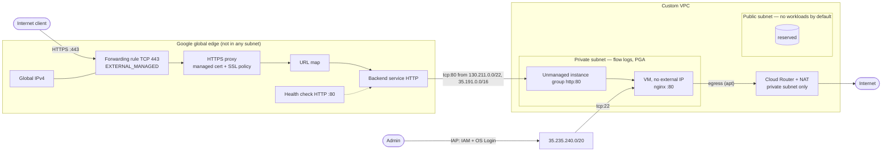

# Task 1 — Secure GCP Infrastructure with Terraform

> **Status: implemented and validated offline. Not deployed.**
> No `terraform plan` or `apply` was run against a real GCP project, and no
> GCP credentials were used. All results below come from offline runs on
> 2026-11-03 against a **mock provider**. Runtime behaviour (nginx serving,
> backend health, certificate issuance) has **not** been observed.

The architecture and its reasoning are in [DESIGN.md](DESIGN.md) (approved
revision 2 plus the implementation notes in §17). This README covers usage,
security controls and validation.

## Contents

- [Assessment requirements](#assessment-requirements)
- [Architecture](#architecture)
- [Module structure](#module-structure)
- [Prerequisites](#prerequisites)
- [Usage](#usage)
- [Inputs](#inputs)
- [Outputs](#outputs)
- [How it works](#how-it-works)
- [Validation](#validation)
- [Known limitations](#known-limitations)

## Assessment requirements

Verbatim from the brief, *1. Secure GCP Infrastructure with Terraform*:

> Write a **Terraform module** that deploys the following resources securely in **Google Cloud Platform (GCP)**:
>
> - A VPC network with a public and private subnet.
> - A Compute Engine instance in the private subnet.
> - A Global HTTP Load Balancer in the public subnet that routes traffic to the Compute Engine instance.
> - Firewall rules that:
>   - Allow only HTTPS (443) from the internet to the Load Balancer.
>   - Allow only SSH (22) from a trusted IP range (not 0.0.0.0/0) to the Compute Engine instance.
>   - Allow only HTTP (80) from the Load Balancer to the Compute Engine instance.
>
> **Bonus**: Implement least privilege IAM roles for resources instead of using roles/editor or roles/owner.

| Requirement | Implementation | Where |
|---|---|---|
| VPC with public and private subnet | Custom-mode VPC, two regional subnets. GCP has no subnet "public" flag; the split is enforced by no external IPs, service-account firewall targets and NAT scope. | [network.tf](network.tf) |
| VM in the private subnet | One VM, private subnet, **no external IP**, Shielded VM, OS Login | [compute.tf](compute.tf) |
| Global HTTP(S) LB to the VM | Global external Application LB (`EXTERNAL_MANAGED`) → unmanaged instance group. A global LB runs on Google's edge and **cannot** be placed in a subnet. | [load_balancer.tf](load_balancer.tf) |
| Only 443 from the internet to the LB | The only frontend is a TCP 443 forwarding rule. VPC firewall rules do not apply to Google Front Ends (*"You cannot use Google Cloud firewall rules to prevent traffic from reaching the load balancer"*), so this is enforced by the frontend, not by a firewall rule. | [load_balancer.tf](load_balancer.tf) |
| Only 22 from a trusted range | Firewall `tcp:22` from `ssh_source_ranges` (default: IAP `35.235.240.0/20`). `/0` and anything broader than `/8` is rejected. | [firewall.tf](firewall.tf) |
| Only 80 from the LB | Firewall `tcp:80` from `130.211.0.0/22` and `35.191.0.0/16` only | [firewall.tf](firewall.tf) |
| Bonus: least-privilege IAM | Dedicated VM service account with **no** project roles by default; admin access granted on the single VM / service account; no keys; optional workload roles limited to an explicit 2-role allowlist | [iam.tf](iam.tf) |

## Architecture



### Traffic matrix

| Flow | Source | Destination | Port | Result | Control |
|---|---|---|---|---|---|
| Client → LB | internet | global IP | 443 | allowed, TLS terminated | only frontend |
| Client → LB | internet | global IP | 80 / other | no listener | no other forwarding rule |
| LB / health check → VM | `130.211.0.0/22`, `35.191.0.0/16` | VM service account | 80 | allowed, logged | `allow-lb-to-backend-http` |
| Admin → VM | `ssh_source_ranges` (default IAP) | VM service account | 22 | allowed, logged | `allow-ssh-trusted` |
| Anything else → VMs | `0.0.0.0/0` | all | all | denied, logged | `deny-all-ingress` (priority 65534) |
| Internet → VM directly | any | VM | any | impossible | no external IP; NAT is outbound-only |
| VM → internet | VM | any | any | via Cloud NAT | NAT on private subnet only |

## Module structure

```
task-01-gcp-terraform/
├── main.tf               shared locals: names, Google source ranges, labels
├── versions.tf           Terraform >= 1.9, hashicorp/google ~> 8.9
├── variables.tf          inputs with validation
├── network.tf            VPC, subnets, Cloud Router, Cloud NAT
├── firewall.tf           3 ingress rules
├── iam.tf                VM service account, scoped admin grants
├── compute.tf            VM, unmanaged instance group
├── load_balancer.tf      health check, backend service, URL map, SSL policy, cert, proxy, IP, forwarding rule
├── outputs.tf
├── files/startup.sh      nginx bootstrap (plain bash, no secrets)
├── tests/                terraform test files, static checks, bootstrap stub tests
├── examples/basic/       root module: provider, example tfvars, GCS backend template
├── .tflint.hcl           tflint config (google ruleset pinned)
├── .gitattributes        forces LF for scripts (CRLF would break the VM bootstrap)
├── .terraform.lock.hcl   provider lock (linux/darwin/windows hashes)
└── DESIGN.md
```

The module has no `provider` or `backend` block. HashiCorp recommends that
reusable modules leave provider configuration to the root module, so those
live in [examples/basic](examples/basic).

**Versions:** Terraform `>= 1.9` (cross-variable validation), validated with
1.17.1. Provider `hashicorp/google ~> 8.9`, locked at 8.9.0.

## Prerequisites

Outside Terraform, before `apply`:

| Prerequisite | Why |
|---|---|
| GCP project with billing | Everything |
| APIs enabled: `compute.googleapis.com`, `iap.googleapis.com`, `oslogin.googleapis.com` | Resources, IAP tunnel, OS Login. Not enabled by the module. |
| **A domain you control** | Google-managed certificate |
| **DNS A record** for each domain → `load_balancer_ip` output | Certificate issuance. Create it after the first apply. |
| Deployer identity with the roles below, using short-lived credentials | `apply` |
| GCS state bucket (versioning, uniform access, public access prevention) | State security, see [backend.tf.example](examples/basic/backend.tf.example) |
| Admins: project-level `compute.projects.get`, `compute.instances.get/list` (for example `roles/compute.viewer`) | `gcloud compute ssh` needs them. Not granted by the module. |
| Optional: Cloud VPN / Interconnect | Only for SSH mode 2 (private connectivity) |
| Recommended: IAP Data Access audit logs enabled | Records which user opened each IAP tunnel |

### Authentication

Use Application Default Credentials (`gcloud auth application-default login`),
optionally with `impersonate_service_account` in the example, or Workload
Identity Federation in CI. **Never use a service account JSON key.**

### Deployer permissions (not managed by the module)

| Role | Used for |
|---|---|
| `roles/compute.networkAdmin` | VPC, subnets, router, NAT, LB resources, global address |
| `roles/compute.securityAdmin` | Firewall rules, SSL policy and certificates |
| `roles/compute.instanceAdmin.v1` | VM and instance group |
| `roles/iam.serviceAccountAdmin` | Create the VM service account, set IAM on it |
| `roles/iam.serviceAccountUser` (on the VM service account) | Attach it to the VM |
| `roles/iap.admin` | IAP tunnel IAM on the VM |
| `roles/resourcemanager.projectIamAdmin` | **Only if** `vm_service_account_roles` is non-empty |

A custom role with exactly these `compute.*` permissions is tighter and is
the recommended production step.

## Usage

```bash
cd examples/basic
cp terraform.tfvars.example terraform.tfvars     # edit: project, region, zone, domain, admins
# optional: cp backend.tf.example backend.tf     # and set a real bucket
terraform init
terraform plan -out tfplan
terraform apply tfplan                            # needs approval and real credentials; NOT run here
terraform output load_balancer_ip                 # create the DNS A record(s) for your domain(s)
```

**A successful `apply` does not mean the service works.** The startup script
runs inside the VM after Terraform returns, and the managed certificate
becomes `ACTIVE` only after DNS points to the LB. That can take up to 60
minutes after DNS propagation, plus up to 30 minutes before the LB serves
it. See [Runtime verification](#runtime-verification-not-run).

## Inputs

| Name | Type | Default | Notes |
|---|---|---|---|
| `project_id` | string | required | valid project ID |
| `region` | string | required | e.g. `europe-west1` |
| `zone` | string | required | must be inside `region` |
| `name_prefix` | string | `"secure-web"` | 4–20 chars |
| `labels` | map(string) | `{}` | GCP label rules |
| `public_subnet_cidr` | string | `"10.10.0.0/24"` | canonical IPv4, /8–/29, **entire range** inside 10.0.0.0/8, 172.16.0.0/12 or 192.168.0.0/16 |
| `private_subnet_cidr` | string | `"10.10.1.0/24"` | as above, must not overlap public |
| `enable_cloud_nat` | bool | `true` | `false` requires `boot_image_includes_nginx = true` |
| `ssh_source_ranges` | list(string) | `["35.235.240.0/20"]` | IPv4, canonical, prefix ≥ /8; `0.0.0.0/0`, `::/0` rejected |
| `ssh_admin_members` | list(string) | `[]` | `user:`/`group:`/`serviceAccount:` only |
| `ssh_admin_sudo` | bool | `false` | `true` → `roles/compute.osAdminLogin` |
| `machine_type` | string | `"e2-small"` | |
| `boot_image` | string | `"debian-cloud/debian-12"` | must be Debian-based (apt) |
| `boot_image_includes_nginx` | bool | `false` | set only for a pre-baked image |
| `boot_disk_size_gb` | number | `20` | 10–100 |
| `boot_disk_kms_key_self_link` | string | `null` | optional CMEK |
| `vm_service_account_roles` | set(string) | `[]` | allowlist: only `roles/logging.logWriter`, `roles/monitoring.metricWriter` |
| `deletion_protection` | bool | `true` | |
| `managed_certificate_domains` | list(string) | `[]` | exactly one of this / `ssl_certificate_self_links` |
| `ssl_certificate_self_links` | list(string) | `[]` | existing certificates (BYO); no keys pass through the module |
| `ssl_policy_profile` | string | `"RESTRICTED"` | `RESTRICTED` or `MODERN` |
| `ssl_min_tls_version` | string | `"TLS_1_2"` | `TLS_1_2` or `TLS_1_3`; `TLS_1_3` requires `RESTRICTED` |
| `health_check_path` | string | `"/"` | |
| `security_policy` | string | `null` | optional existing Cloud Armor policy |

## Outputs

`network_id`, `network_self_link`, `public_subnet_id`, `private_subnet_id`,
`public_subnet_self_link`, `private_subnet_self_link`, `instance_id`,
`instance_name`, `instance_self_link`, `instance_internal_ip`,
`instance_group_self_link`, `vm_service_account_email`, `load_balancer_ip`,
`https_url`, `backend_service_id`, `managed_certificate_name`,
`ssl_policy_id`, `ssh_command_iap`, `ssh_command_internal_ip`.

No output is secret, so none is marked `sensitive`. The module creates no
credentials.

## How it works

### Firewall and backend access

- Rules target the **VM service account**, not network tags. Tags can be
  changed with `compute.instances.setTags`. Changing a VM's service account
  needs `iam.serviceAccounts.actAs` and a stopped VM.
- `tcp:80` is allowed only from Google's load balancer ranges:
  `130.211.0.0/22` and `35.191.0.0/16`. Health checks for this LB type come
  from `35.191.0.0/16`.
  ([LB docs](https://docs.cloud.google.com/load-balancing/docs/https),
  [health checks](https://docs.cloud.google.com/load-balancing/docs/health-check-concepts))
- These ranges are shared by every Google Front End, so the firewall cannot
  tell *this* LB from another. See limitations.
- A logged deny-all rule (priority 65534) records blocked ingress. Google's
  implied deny rule is not logged.

### SSH: IAP (default) and private connectivity (optional)

| | Mode 1: IAP (default) | Mode 2: private connectivity (optional) |
|---|---|---|
| Needs | IAP API; admin in `ssh_admin_members`; project-level compute read | **Existing** Cloud VPN/Interconnect routing to the private subnet |
| `ssh_source_ranges` | `["35.235.240.0/20"]` | add the admins' **private** CIDR, e.g. `10.20.0.0/16` |
| Command | `gcloud compute ssh INSTANCE --zone ZONE --project PROJECT --tunnel-through-iap` | `gcloud compute ssh INSTANCE --zone ZONE --project PROJECT --internal-ip` |
| Source IP seen by the firewall | an IAP forwarder address | the admin's private IP |

`35.235.240.0/20` is **IAP's forwarder range, not the administrator's IP**.
Allowing it means "allow IAP". Access control comes from IAM on the tunnel
plus OS Login, and user identity appears in IAP audit logs, not firewall
logs. The VM has no external IP, so a public office CIDR in
`ssh_source_ranges` would not make it reachable.

Per-admin grants (from `ssh_admin_members`):

- `roles/iap.tunnelResourceAccessor` on the VM;
- `roles/compute.osLogin` on the VM (`osAdminLogin` only with `ssh_admin_sudo`);
- `roles/iam.serviceAccountUser` on the VM's service account. OS Login
  requires it when the VM has a service account.

### Certificates and DNS

- **Default:** `google_compute_managed_ssl_certificate`, which Google issues
  and renews. No private key exists in Terraform state or this repo.
- **BYO:** reference an existing certificate via `ssl_certificate_self_links`.
  Uploading a PEM private key through the module is deliberately not
  supported, because the key would land in plaintext state.
- **Issuance:** the public A record of every domain must point to
  `load_balancer_ip`, and the forwarding rule must be on 443 (it is). The
  status stays `PROVISIONING` until then.
- **TLS policy:** default `RESTRICTED` + `TLS_1_2`. Only three combinations
  are accepted:

  | Profile | `TLS_1_2` | `TLS_1_3` |
  |---|---|---|
  | `RESTRICTED` | accepted (default) | accepted |
  | `MODERN` | accepted | **rejected** (Google requires `RESTRICTED` for TLS 1.3) |
  | `COMPATIBLE` / `FIPS_202205` / `CUSTOM`, or `TLS_1_0` / `TLS_1_1` | rejected | rejected |

  Enforced by a cross-variable validation (Terraform ≥ 1.9) and duplicated as
  a resource precondition on `google_compute_ssl_policy`.

### Certificate rotation

**What the module does.** The managed certificate's domain list cannot be
edited in place, so changing `managed_certificate_domains` replaces the
certificate in a single apply. The name carries a hash of the domains, and
`create_before_destroy` makes Terraform:

1. create the new certificate;
2. point the HTTPS proxy at the new certificate **only**;
3. delete the old one.

This avoids a "certificate in use" delete error. It is **not** a
zero-downtime rotation. The new certificate stays `PROVISIONING` until Google
validates DNS. That can take up to 60 minutes after DNS propagates, and the
LB can take up to 30 minutes more to serve it. HTTPS can fail during that
window.

**Recommended staged rotation (manual; not automated by this module):**

1. Create the replacement certificate outside this module, for example with
   `gcloud compute ssl-certificates create ... --domains=...` or a separate
   Terraform configuration.
2. Reference **both** old and new certificates on the proxy: deploy with
   `ssl_certificate_self_links = [old, new]` (BYO mode). A target HTTPS proxy
   accepts several certificates.
3. Wait until the new certificate is `ACTIVE` and has propagated to the LB
   (`gcloud compute ssl-certificates describe NEW --global`, then test with
   `curl`).
4. Only then remove the old certificate from the list, apply, and delete it.

For a certificate this module created itself, moving to BYO mode means
handing that certificate over to the external configuration first (for
example `terraform state rm` plus import elsewhere). Otherwise switching
modes would make Terraform delete the certificate. That handover is an
operator procedure and has not been tested here.

### Bootstrap and Cloud NAT

1. **Egress path:** Cloud NAT serves **only** the private subnet's primary
   range (`LIST_OF_SUBNETWORKS`, `PRIMARY_IP_RANGE`), with error logging.
   The VPC keeps its default internet route, which NAT needs.
2. **Ordering:** the VM has `depends_on = [google_compute_router_nat.this]`.
   Nothing in the VM refers to NAT, so without this Terraform could create
   both in parallel. This orders API calls only, not NAT data-plane readiness.
3. **[files/startup.sh](files/startup.sh)** runs as root on every boot:
   - `set -Eeuo pipefail` and a `flock` against concurrent runs;
   - skips the install if nginx is already present (idempotent);
   - otherwise runs `apt-get update && install nginx`, each attempt bounded by
     `timeout 120`, with 5 attempts and backoff of 10/20/40/80 s (about
     12.5 min worst case);
   - writes `index.html` only if its content changed;
   - runs `systemctl enable --now nginx`, then a local check that nginx
     answers `http://127.0.0.1/`.
4. **Result signals:**
   - Success: `/var/lib/secure-web/bootstrap.ok` and the log line `SECURE_WEB_BOOTSTRAP=OK`.
   - Failure (**fail closed**): any stale `bootstrap.ok` is removed;
     `/var/lib/secure-web/bootstrap.failed` names the failed step; the log line
     `SECURE_WEB_BOOTSTRAP=FAILED step=<step>` is written; the exit is non-zero.
   - If this run holds the bootstrap lock, nginx is **stopped and disabled**,
     even if it was already running from an earlier boot. The health check on
     `/` then fails and the LB stops sending traffic. Disabling it stops a
     reboot from bringing nginx back before the script succeeds again.
   - A run that could not get the lock leaves nginx alone, because another run
     owns the bootstrap.
   - The next successful run re-enables and starts nginx, and writes `bootstrap.ok`.
5. **NAT disabled:** `enable_cloud_nat = false` is **rejected** unless
   `boot_image_includes_nginx = true`. Otherwise the bootstrap could never
   succeed.

### IAM

- **Workload:** dedicated service account `<prefix>-vm`, `cloud-platform`
  scope (Google's recommendation), **zero** project roles by default. It
  serves a static page and calls no Google APIs. No keys.
- **Optional roles** via `vm_service_account_roles`. This is an **explicit
  allowlist** of exactly `roles/logging.logWriter` and
  `roles/monitoring.metricWriter`: write-only telemetry roles for an Ops
  Agent. Every other role is rejected, including `owner`/`editor`/`viewer`,
  versioned admin roles such as `roles/compute.instanceAdmin.v1`,
  impersonation roles and custom roles. A role's name does not prove it is
  low-privilege, so there is no name-pattern matching. The same allowlist is
  enforced again by a precondition on `google_project_iam_member.vm`.
- **Admin grants** are scoped to the VM and its service account, as above.
- **Deployer** roles are documented [above](#deployer-permissions-not-managed-by-the-module), not granted.

### VM hardening

No external IP. Shielded VM (secure boot, vTPM, integrity monitoring). OS
Login on. Project SSH keys blocked. Interactive serial port off. IP
forwarding off. Deletion protection on by default. Boot disk always
encrypted (Google-managed; optional CMEK).

## Validation

### Commands

From `task-01-gcp-terraform/`:

```bash
terraform fmt -recursive -check
terraform init -backend=false -input=false
terraform validate
(cd examples/basic && terraform init -backend=false -input=false && terraform validate)
terraform test                          # mock provider; no credentials, no API calls
bash tests/static_checks.sh             # inventory, forbidden patterns, VM->NAT graph edge, secrets
bash tests/bootstrap/test_startup.sh    # real startup.sh against stub apt/systemctl/curl
shellcheck files/startup.sh tests/bootstrap/test_startup.sh tests/static_checks.sh
tflint --init && tflint --recursive
trivy config --skip-dirs .terraform --skip-dirs examples/basic/.terraform .
trivy fs --scanners secret --skip-dirs .terraform --skip-dirs examples/basic/.terraform .
checkov -d . --framework terraform --skip-path .terraform --skip-path examples/basic/.terraform
```

### Results (real runs, 2026-11-03, Windows 11, Git Bash 5.2.37)

Re-run in full after the fixes for the Codex final security review.

| Check | Tool / version | Result |
|---|---|---|
| Format | Terraform 1.17.1 | `fmt -check`: no changes, exit 0 |
| Validate (module) | Terraform 1.17.1, google 8.9.0 | `Success! The configuration is valid.` |
| Validate (example) | same | `Success! The configuration is valid.` |
| Native tests | `terraform test` (mock provider) | **94 passed, 0 failed** in 5 files |
| Static checks | `tests/static_checks.sh` | **18 passed, 0 failed** |
| Bootstrap behaviour | `tests/bootstrap/test_startup.sh` | **93 passed, 0 failed** (15 scenarios) |
| Whitespace | `git diff --check` | clean |
| Shell lint | shellcheck 0.11.0, `bash -n` | no findings; syntax OK |
| Lint | tflint 0.65.0, ruleset google 0.41.0, terraform 0.15.0 (`preset = "all"`) | **0 issues** |
| IaC scan | trivy 0.76.1 `config` | **0 misconfigurations**, 1 inline-justified ignore (below) |
| Secret scan | trivy 0.76.1 `fs --scanners secret` | no secrets found |
| IaC scan | checkov 3.4.2 | **42 passed, 0 failed, 0 skipped** (26 distinct checks) |

Test coverage:

| File | Covers |
|---|---|
| [secure_defaults.tftest.hcl](tests/secure_defaults.tftest.hcl) | VPC and subnets, no external IP, VM hardening, UIG named port 80, firewall sources/ports/targets, no `0.0.0.0/0` allow, LB chain on 443 only, backend HTTP:80, outputs, BYO cert |
| [bootstrap.tftest.hcl](tests/bootstrap.tftest.hcl) | default route kept, NAT covers only the private subnet's primary range, startup script wiring, LF endings, required controls, no credentials, NAT-disabled rules |
| [tls_policy.tftest.hcl](tests/tls_policy.tftest.hcl) | 3 accepted combinations; **MODERN + TLS_1_3 rejected**; TLS 1.0/1.1, COMPATIBLE, FIPS, CUSTOM rejected |
| [iam.tftest.hcl](tests/iam.tftest.hcl) | no default grants; resource-scoped admin grants; sudo opt-in; **role allowlist**: `logWriter`, `metricWriter`, both, or empty accepted; `roles/compute.instanceAdmin.v1`, `compute.admin`, `owner`, `editor`, `viewer`, `iam.serviceAccountTokenCreator`, `iam.serviceAccountUser`, `compute.viewer`, `storage.objectViewer`, a custom role, and allowed + disallowed mixed all rejected; allUsers/domain admins rejected |
| [input_validation.tftest.hcl](tests/input_validation.tftest.hcl) | SSH ranges (`0.0.0.0/0`, `::/0`, `/1`, non-canonical, empty) rejected, IAP + VPN accepted; subnet overlap / non-RFC 1918 / too small rejected; **RFC 1918 containment for each subnet input separately**: `192.168.0.0/15`, `192.168.0.0/14`, `172.16.0.0/11`, `10.0.0.0/7`, `8.8.8.0/24`, `172.32.0.0/24`, `11.0.0.0/8`, IPv6, malformed rejected; `10.0.0.0/8`, `172.16.0.0/12`, `172.31.255.0/24`, `192.168.0.0/16`, `192.168.255.248/29` accepted; zone/region; certificate inputs |
| [static_checks.sh](tests/static_checks.sh) | exact resource inventory (23 blocks, no data sources), forbidden types, no `access_config`, no primitive roles, `0.0.0.0/0` only in deny rule, **VM → NAT edge in `terraform graph`**, credential patterns |
| [test_startup.sh](tests/bootstrap/test_startup.sh) | happy path; transient failure; permanent failure; idempotency; self-check failure; override clamps; recovery; service failure; no credentials. **Fail closed** (B-SH-10 to 15), each starting from a previously healthy VM (nginx running and enabled, stale `bootstrap.ok`): install failure, content failure and self-check failure each stop **and** disable nginx, remove the stale marker and record the step; failure to get the lock leaves nginx untouched; a later successful run restores nginx; three successful runs in a row never stop nginx. The stubs model nginx state, so `curl` only succeeds while nginx is "running". |

**Do the tests fail when they should?** Mutation checks were run on copies
outside the repo. Each of these was caught by at least one failing test:

- Terraform: adding an external IP, NAT covering all ranges, a weakened SSH
  CIDR rule, opening the backend firewall to `0.0.0.0/0`, the frontend on
  port 80, OS Login off, removing the TLS cross-variable rule, removing
  `depends_on`.
- Bootstrap script: 5 → 6 attempts, linear backoff, the idempotency check
  removed, the attempt clamp raised, the ERR trap removed, the stale
  failure marker left behind.
- Fail-closed fix: removing `withdraw_readiness` (17 failures), not setting
  `LOCK_HELD` (16), skipping `disable` (7), not removing `bootstrap.ok` (4),
  stopping nginx without holding the lock (3).

**Regression proof against the pre-fix code.** The new tests were run against
saved copies of the code before the fix:

- **`startup.sh`:** 17 assertions failed in B-SH-10 to 14. nginx kept
  running after terminal failures.
- **`variables.tf` + `iam.tf`:** each new run was put in its own file
  (Terraform skips a file's remaining runs after a failure), giving 9 of 41
  failing. The old code accepted `roles/compute.instanceAdmin.v1`,
  allowed + admin mixed, `compute.viewer`, `storage.objectViewer` and a
  custom role, plus `192.168.0.0/15` and `/14` for both subnet inputs.
- **Already rejected before the fix:** `172.16.0.0/11`, `10.0.0.0/7` and
  `8.8.8.0/24` failed the old canonical-address, prefix-length or text checks,
  not a containment check. They stay as regression coverage.
- **After the fix,** all of these pass.
- **IAM precondition:** with the variable validation deliberately weakened
  on a scratch copy, the precondition on `google_project_iam_member.vm` alone
  rejected `roles/compute.instanceAdmin.v1`. The precondition cannot fire
  while the validation is intact, so that proof is not part of the repo
  suite.

**Scanner exceptions:**

- **trivy `GCP-0074`** ("large port range") on the deny-all rule is ignored
  inline. It is a false positive: the rule *denies* every port.
- **trivy `GCP-0075`** (Private Google Access off on the public subnet) was
  **fixed**, not ignored.
- **checkov `CKV_GCP_38`** (CSEK disks) passes because checkov sees the
  optional `kms_key_self_link` reference. The actual default is
  Google-managed encryption. Customer-supplied raw keys are deliberately not
  used, because they would sit in state.

**Mock-provider limits:**

- `command = apply` in tests runs against `mock_provider "google"` and
  creates nothing.
- Mocks fill unset optional+computed attributes with random values, so the
  default "no CMEK" cannot be asserted.
- Mocks do not run Google's server-side validation. A real `plan`/`apply`
  could still reject something these tests accept, for example quota limits
  or an image that doesn't exist.

**Local environment note.** On this workstation, Norton Antivirus intercepts
TLS. That breaks the local mTLS handshake between Terraform and its provider
plugin (`x509: certificate signed by unknown authority`), even for
`terraform validate`. The commands above were run with the provider started
in debug mode (`terraform-provider-google_v8.9.0_x5.exe -debug`) and
attached via `TF_REATTACH_PROVIDERS`. That uses the same provider binary and
schema; only the local plugin transport differs. `terraform init` and
`terraform providers lock` ran normally. On a machine without TLS
interception, or in CI, the commands work as written.

**Tool setup.** tflint 0.65.0 and trivy 0.76.1 were downloaded from their
GitHub releases and matched the published SHA-256 checksums. shellcheck
0.11.0 publishes no checksum file; the zip's SHA-256 was
`8a4e35ab0b331c85d73567b12f2a444df187f483e5079ceffa6bda1faa2e740e`.
checkov 3.4.2 was installed from PyPI into a temporary virtualenv (Python
3.11.2) with TLS verification against Norton's root certificate (not
disabled). All tools were kept outside the repository.

### Runtime verification (not run)

These need an authorized deployment and have **not** been run:

| # | Check | Pass condition |
|---|---|---|
| V1 | `gcloud compute instances get-serial-port-output INSTANCE --zone ZONE \| grep SECURE_WEB_BOOTSTRAP` | `SECURE_WEB_BOOTSTRAP=OK` |
| V2 | via IAP: `systemctl is-active nginx`, `curl -s -o /dev/null -w '%{http_code}' http://127.0.0.1/`, `test -f /var/lib/secure-web/bootstrap.ok` | `active`, `200`, marker present |
| V3 | `gcloud compute backend-services get-health BACKEND --global` | `HEALTHY` |
| V4 | Cloud NAT logs (`ERRORS_ONLY`) | no errors during bootstrap |
| V5 | `gcloud compute ssl-certificates describe CERT --global` | `managed.status: ACTIVE` |
| V6 | `curl -s -o /dev/null -w '%{http_code}' https://DOMAIN/` | `200` |
| V7 | `curl -m 5 http://LB_IP/` | fails (no port-80 frontend) |
| V8 | `gcloud compute instances describe INSTANCE --format='value(networkInterfaces[0].accessConfigs)'` | empty |
| V9 | IAP SSH as a granted vs. non-granted user | allowed / denied |

## Known limitations

1. **Not deployed.** Runtime readiness cannot be proven offline. `depends_on`
   orders API calls; whether NAT forwards traffic in time and nginx answers
   health checks can only be shown by a real deployment.
2. **Shared GFE ranges.** The port-80 rule admits any Google Front End
   traffic, not only this LB's. Hardening options: HTTPS to the backend, or
   a header set by the backend service and checked by nginx.
3. **HTTP between LB and VM**, as required by the brief (port 80). No TLS on
   that hop.
4. **Single VM, single zone, no autohealing.** A terminal bootstrap failure
   deliberately takes the only backend out of service (nginx stopped and
   disabled), so the site is down until a reboot or recreate re-runs the
   script successfully. That is the intended fail-closed trade-off.
   - Fail-closed applies to failures the script detects. If nginx later dies
     or is restarted by an operator outside the script, readiness follows
     nginx's real state through the health check.
   - If the stop or disable call itself fails, the script logs a warning
     and still exits non-zero.
5. **Certificate rotation is not zero-downtime.** Changing
   `managed_certificate_domains` swaps to a certificate that is still
   provisioning. Use the staged procedure in
   [Certificate rotation](#certificate-rotation) when continuity matters.
6. **Bootstrap needs internet egress** (apt via NAT). A pre-baked image is the
   production answer (`boot_image_includes_nginx`).
7. **Certificate lifecycle is outside Terraform.** DNS must be created
   manually after the first apply.
8. **Public subnet hosts nothing.** The brief asks for it; a global LB
   cannot be placed in it.
9. **IAP cannot restrict by client IP** without Access Context Manager (an
   organization-level feature).
10. **Some admin permissions are project-level** (`compute.projects.get`).
   They are documented, not granted.
11. **VM egress is open** through NAT (implied allow egress).
12. **Debian 12 image default.** Confirm the preferred image family before
    deploying.
